# T-SQL Lecture: Variables, Control Flow, Transactions & Functions

> **Topics:** Variables · IF · IF EXISTS · WHILE · BEGIN / END · TRY / CATCH · Batch / Script / Transaction · Functions · Windowing
>
> 📄 All code runs from [`script.sql`](script.sql) · ✏️ Practice in [`tasks.md`](tasks.md)

## Table of Contents

1. [Variables](#1-variables)
2. [Table Variables & Dynamic SQL](#2-table-variables--dynamic-sql)
3. [Control of Flow](#3-control-of-flow)
4. [IF vs IF EXISTS](#4-if-vs-if-exists)
5. [TRY / CATCH](#5-try--catch)
6. [Batch vs Script vs Transaction](#6-batch-vs-script-vs-transaction)
7. [How the Database Works](#7-how-the-database-works)
8. [How a Transaction Works (Parent / Child)](#8-how-a-transaction-works-parent--child)
9. [Functions](#9-functions)
10. [Windowing Functions (LAG / LEAD)](#10-windowing-functions-lag--lead)

---

## 1. Variables

A variable stores a value temporarily so you can reuse it. In SQL Server there are two kinds:

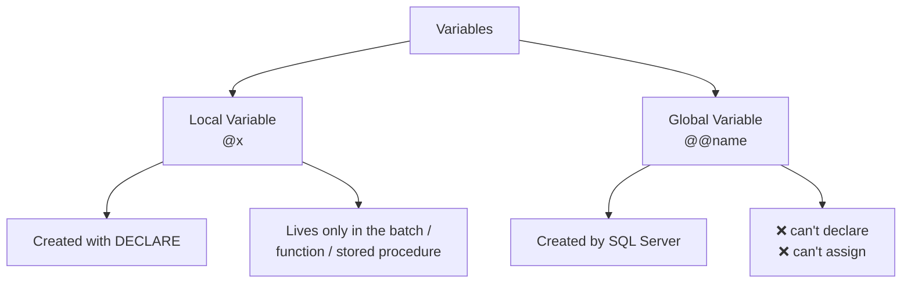

### 1.1 Local variables

```sql
DECLARE @x INT          -- 1) declare with a type
SET @x = 10             -- 2a) assign with SET
SELECT @x = 100         -- 2b) assign with SELECT
SELECT @x               -- 3) read it
```

> A **batch** = a set of statements you select and run together. A local variable only lives inside its batch.

### 1.2 Save a query result in a variable

```sql
DECLARE @x INT = (SELECT AVG(st_age) FROM student)
SELECT @x
```

`@x` now holds the result of the query.

### 1.3 Assign vs display ⚠️

```sql
DECLARE @y INT
SELECT @y = st_age FROM student WHERE st_id = 6
```

Here you **only assigned** the value to `@y`. Nothing appears in the results panel. To see it, run `SELECT @y`.

| Statement | Assigns? | Displays? |
|---|---|---|
| `SELECT @y = st_age FROM student ...` | ✅ | ❌ |
| `SELECT @y` | ❌ | ✅ |

### 1.3b Update and assign in the same statement

```sql
DECLARE @z INT
UPDATE student SET st_fname = 'ali', @z = dept_id
WHERE st_id = 7
SELECT @z
```

While updating the student, we also grab the `dept_id` of that row and save it in `@z`.

**Benefit:** two operations (update + read) with **one** access to the hard disk, instead of two separate queries.

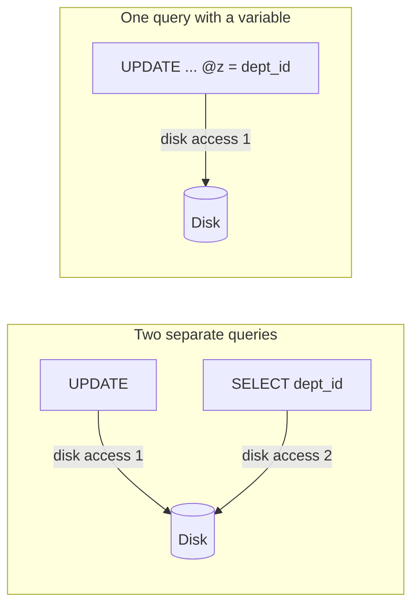

### 1.4 Global variables

| Variable | Returns |
|---|---|
| `@@SERVERNAME` | Name of the server |
| `@@ROWCOUNT` | Number of rows affected by the **last** statement |
| `@@VERSION` | SQL Server version |
| `@@ERROR` | Error number of the last statement (0 = no error) |
| `@@IDENTITY` | Last identity value inserted |

```sql
SELECT @@SERVERNAME
SELECT @@ROWCOUNT
SELECT @@VERSION
SELECT @@ERROR
SELECT @@IDENTITY
```

> 💡 `@@ROWCOUNT` and `@@ERROR` change after **every** statement, so copy them into a variable right away.

---

## 2. Table Variables & Dynamic SQL

### 2.1 Table variable (an "array")

A normal variable holds **one** value. When a query returns many values, declare a variable of type **table**:

```sql
DECLARE @t TABLE (x INT)
INSERT INTO @t
SELECT st_id FROM student WHERE st_address = 'alex'

SELECT COUNT(*) FROM @t
```

### 2.2 EXECUTE: dynamic queries

You **cannot** use a variable as a column or table name:

```sql
DECLARE @col VARCHAR(20) = '*', @tab VARCHAR(20) = 'student'
SELECT @col FROM @tab          -- ❌ error
```

`EXECUTE` takes a **string** and runs it as a query:

```sql
SELECT 'select * from student'      -- only returns text
EXECUTE('select * from student')    -- runs the query ✅
```

**Benefit:** the query becomes dynamic. Change `@tab` and `@col` and the same code works on any table:

```sql
DECLARE @col VARCHAR(20) = 'ins_name', @tab VARCHAR(20) = 'instructor'
EXECUTE('select ' + @col + ' from ' + @tab)
```

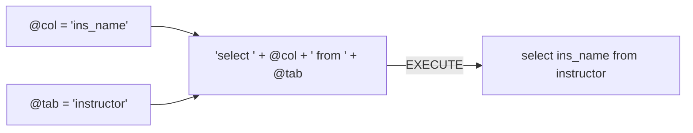

> ⚠️ Never build dynamic SQL from text typed by users (SQL injection). Use `sp_executesql` with parameters in real projects.

---

## 3. Control of Flow

The lecture's roadmap, the statements that control **which** code runs and **how many times**:

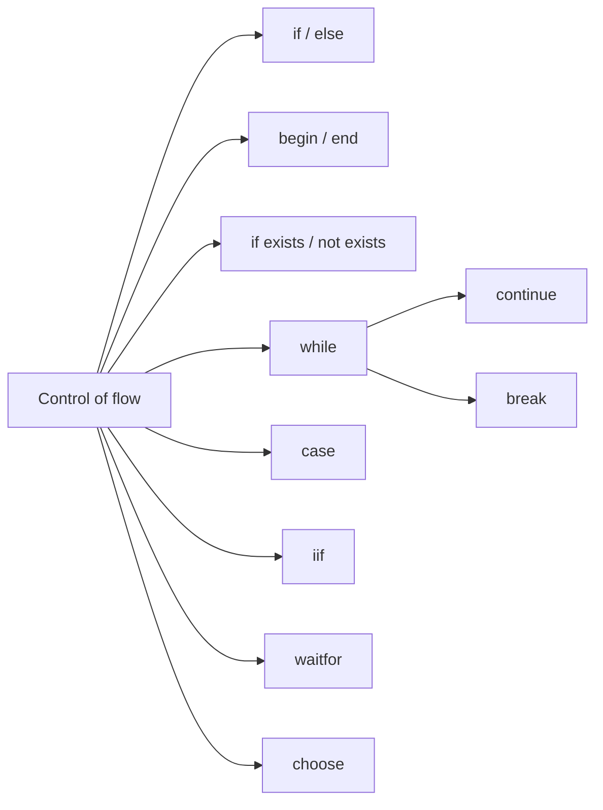

### 3.1 Basic IF / ELSE

```sql
DECLARE @x INT
UPDATE student SET st_age += 1
SELECT @x = @@ROWCOUNT
IF @x > 0
    SELECT 'multi rows Affected'
ELSE
    SELECT 'No Rows Affected'
```

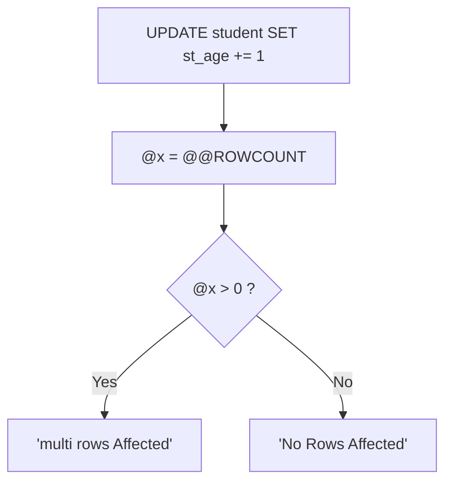

### 3.2 BEGIN ... END instead of `{ }`

SQL has no curly braces. If a branch has **more than one statement**, wrap it in `BEGIN ... END`. With a single statement they're optional.

```sql
IF @x > 0
BEGIN
    SELECT 'multi rows Affected'
    SELECT @x
END
ELSE
BEGIN
    SELECT 'No Rows Affected'
END
```

### 3.3 IF EXISTS: check before you execute

The purpose is to **check before executing** a query, for example creating a table only if it isn't there yet:

```sql
IF EXISTS (SELECT * FROM sys.tables
           WHERE name = 'students' AND schema_id = SCHEMA_ID('dbo'))
    SELECT 'table is existed'
ELSE
    CREATE TABLE students
    (
        id INT,
        name VARCHAR(20)
    )
```

### 3.4 WHILE, BREAK, CONTINUE

```sql
DECLARE @i INT = 0
WHILE @i < 10
BEGIN
    SET @i += 1
    IF @i = 3 CONTINUE     -- skip this round
    IF @i = 7 BREAK        -- leave the loop
    SELECT @i
END
```

### 3.5 CASE, IIF, CHOOSE, WAITFOR

```sql
SELECT st_fname,
       CASE WHEN st_age < 22 THEN 'young' ELSE 'older' END,
       IIF(st_age >= 23, 'yes', 'no')
FROM student

SELECT CHOOSE(2, 'first', 'second', 'third')   -- second
WAITFOR DELAY '00:00:03'                        -- pause 3 seconds
```

---

## 4. IF vs IF EXISTS

| Feature | `IF` | `IF EXISTS` |
|---|---|---|
| Purpose | Checks a condition | Checks whether a row / object exists |
| Example | `IF @Age > 18` | `IF EXISTS (SELECT 1 FROM Employees)` |
| Requires a subquery? | No | Yes, for the row-existence form |
| Typical use | Business logic | Checking rows or database objects |

---

## 5. TRY / CATCH

Instead of checking with `IF EXISTS` first, **try** the operation and handle the error if it fails:

```sql
BEGIN TRY
    DELETE FROM department WHERE dept_id = 20
END TRY
BEGIN CATCH
    SELECT 'error'
    SELECT ERROR_LINE(), ERROR_NUMBER(), ERROR_MESSAGE()
END CATCH
```

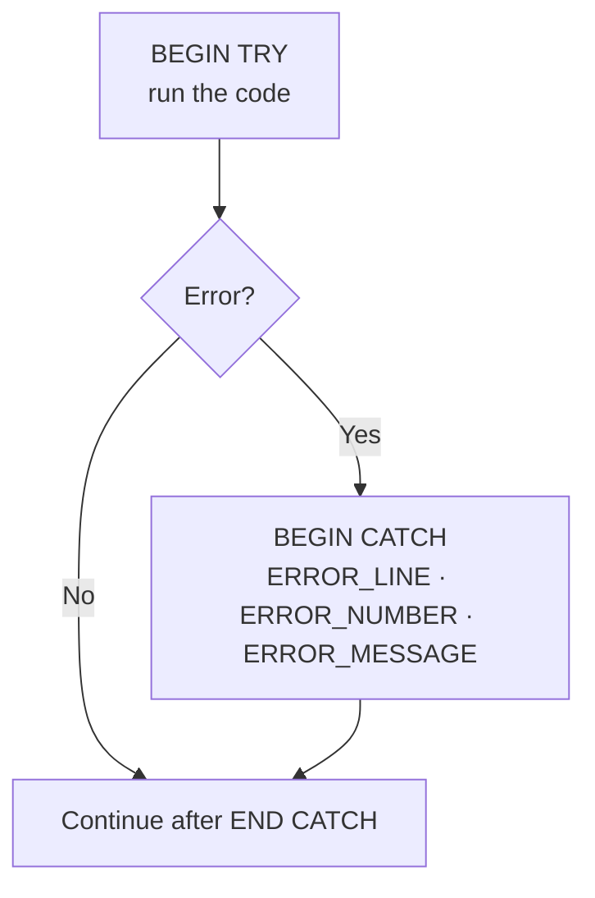

In our data, department 20 still has students, so the delete breaks the foreign key and the `CATCH` block runs.

---

## 6. Batch vs Script vs Transaction

| Term | Meaning |
|---|---|
| **Batch** | Separate queries compiled/sent together, with **no relation** between them |
| **Script** | Several batches separated by `GO` |
| **Transaction** | A group of statements treated as **one unit**: all succeed (commit) or all are undone (rollback) |

### Batch

```sql
-- batch
insert ...
update ...
delete ...
```

### Script

Some statements (like `CREATE TABLE` followed by `DROP TABLE`) can't be executed together in one batch. We put `GO` between them. This is called a **script**.

```sql
-- script
create table ...
go
drop table ...
go
```

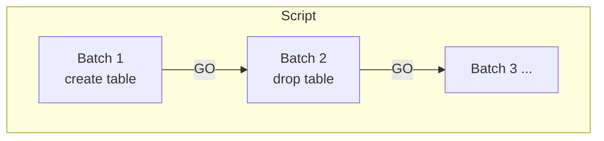

> `GO` is not a T-SQL statement. It's a command understood by SSMS that tells it "send everything above as one batch".

### Transaction (Atomicity)

> A transaction is a group of SQL statements executed as a **single logical unit of work**. Either all of them are committed successfully, or the changes are rolled back if something goes wrong.

This is the **Atomicity** property of **ACID**: all operations succeed as a unit, or the transaction is rolled back.

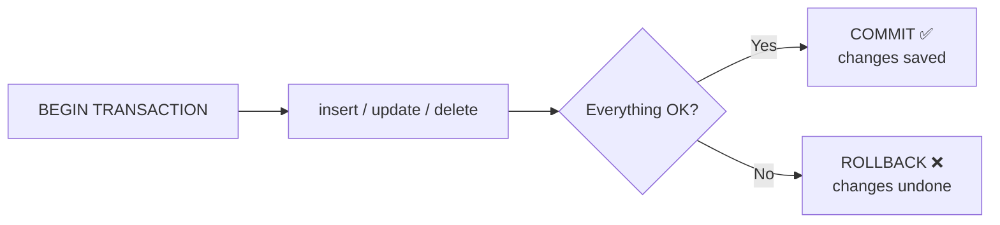

---

## 7. How the Database Works

The lecture explains it through three parts:

| Part | Role in the lecture |
|---|---|
| **SSMS / CMD** | The interface where you write and run the query |
| **LDF** | Log file. The query is executed inside it. Every statement is treated as an **implicit transaction**: if it succeeds → commit, otherwise → rollback |
| **MDF** | The data file. It answers the log file: "OK" or "error, can't do it" |

```mermaid
sequenceDiagram
    participant Q as SSMS / CMD
    participant L as LDF (log)
    participant M as MDF (data)

    Note over Q,M: 1) Implicit transaction - success
    Q->>L: INSERT (F5)
    L->>L: begin transaction → insert
    L->>M: apply insert
    M-->>L: ok
    L->>L: COMMIT

    Note over Q,M: 2) Implicit transaction - failure
    Q->>L: DELETE
    L->>L: begin transaction → delete
    L->>M: apply delete
    M-->>L: error
    L->>L: ROLLBACK

    Note over Q,M: 3) Explicit transaction - server restarts mid-way
    Q->>L: begin tran; insert; update; delete...
    L->>M: insert
    M-->>L: ok
    L->>M: update
    M-->>L: ok
    Note over L: ⚡ Server restarts before COMMIT
    L->>L: automatic ROLLBACK (nothing is saved)
```

- **Implicit transaction:** SQL Server wraps each single statement for you.
- **Explicit transaction:** you write `BEGIN TRANSACTION ... COMMIT / ROLLBACK` yourself.

> 📝 In real SQL Server, the `.mdf` file stores the actual data (tables and system metadata) and the `.ldf` file is the transaction log. The diagram above follows the lecture's simplified explanation.

---

## 8. How a Transaction Works (Parent / Child)

Two tables: **Parent** has `pid`; **Child** has `cid` as a **foreign key** referencing `parent(pid)`. So a child value is only allowed if it already exists in parent.

```sql
create table parent (pid int primary key)
create table Child  (cid int foreign key references parent(pid))
```

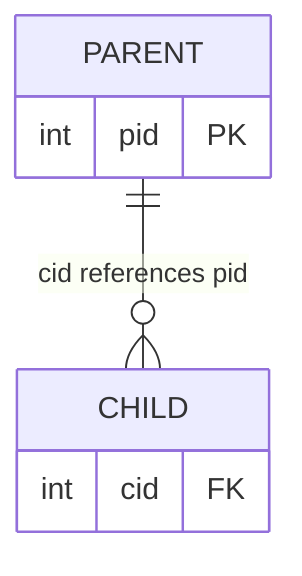

### Example A: a batch

```sql
insert into parent values (1)
insert into parent values (2)
insert into parent values (3)
insert into parent values (4)

insert into child values (1)
insert into child values (5)   -- ❌ 5 is not in parent
insert into child values (3)
```

Each statement is its own implicit transaction, so **only 1 and 3** are stored in `child`; the failed `5` is skipped.

| child value | Exists in parent? | Result |
|---|---|---|
| 1 | ✅ | stored |
| 5 | ❌ | error, skipped |
| 3 | ✅ | stored |

### Example B: explicit transaction + ROLLBACK

```sql
begin transaction
    insert into child values (1)
    insert into child values (2)
    insert into child values (3)
rollback
```

The transaction inserted 1, 2, 3, **then deleted them** because we wrote `rollback`. `child` stays empty.

### Example C: explicit transaction + COMMIT, but with an error

```sql
begin transaction
    insert into child values (1)
    insert into child values (5)   -- ❌ error
    insert into child values (3)
commit
```

This inserted 1 and 3 and ignored 5. So it works **like a batch**, which isn't what we want from a transaction!

> Why? A foreign-key error only cancels its own statement, and SQL Server keeps going. (`SET XACT_ABORT ON` changes this behavior.)

### Example D: where the real benefit is: TRY / CATCH + COMMIT / ROLLBACK

If everything is OK → `commit`. If anything fails → `rollback`.

```sql
begin try
    begin transaction
        insert into child values (1)
        insert into child values (5)   -- error → jump to CATCH
        insert into child values (3)
    commit
end try
begin catch
    rollback
end catch
```

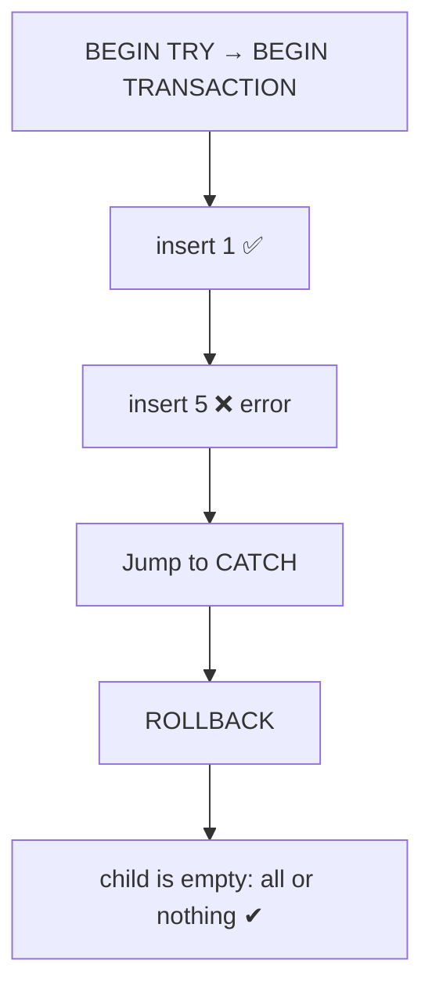

| Example | Result in `child` |
|---|---|
| A: batch | 1, 3 |
| B: explicit + `rollback` | *(empty)* |
| C: explicit + `commit` with an error | 1, 3 (acts like a batch) |
| D: try/catch + commit/rollback | *(empty)*: **all or nothing** |

---

## 9. Functions

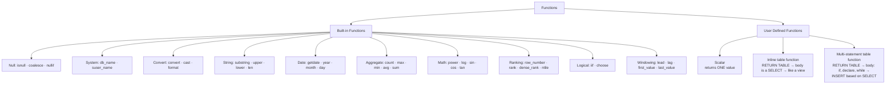

### 9.1 Scalar function: receives an id, returns its name

```sql
create function getsname (@id int)
returns varchar(20)
begin
    declare @name varchar(20)
    select @name = st_fname from student where st_id = @id
    return @name
end
```

Calling it, **you must write the schema name** (`dbo.`). Without it, the server looks for a built-in function with that name.

```sql
select dbo.getsname(1)
```

### 9.2 Inline table-valued function: returns a table

```sql
create function Getist (@did int)
returns table
as
return
(
    select ins_name, salary * 12 as totalsal
    from Instructor
    where dept_id = @did
)
```

Calling it:

```sql
select dbo.Getist(10)       -- ❌ error: the function is not scalar
select * from Getist(10)    -- ✅ treat it like a table
```

### 9.3 Multi-statement table-valued function

The body can contain `declare`, `if`, `while`... and fills the returned table with `INSERT ... SELECT`.

```sql
create function getstuds (@format varchar(20))
returns @t table
(
    id int,
    ename varchar(20)
)
as
begin
    if @format = 'first'
        insert into @t
        select st_id, st_fname from student
    else if @format = 'last'
        insert into @t
        select st_id, st_lname from student
    else if @format = 'full'
        insert into @t
        select st_id, st_fname + ' ' + st_lname from student
    return
end
```

```sql
select * from getstuds('full')
```

### Comparison of the three user-defined functions

| Type | Returns | Body | Call with |
|---|---|---|---|
| Scalar | one value | `begin ... return value end` | `select dbo.fn(...)` |
| Inline table | table | a single `SELECT` (like a view) | `select * from fn(...)` |
| Multi-statement table | table | `declare`, `if`, `while`, `insert ... select` | `select * from fn(...)` |

---

## 10. Windowing Functions (LAG / LEAD)

> **LAG** gets the **previous** value and **LEAD** gets the **next** value, relative to the current row.

```sql
SELECT sname, grade,
       X = LAG(sname)  OVER (ORDER BY grade),
       Y = LEAD(sname) OVER (ORDER BY grade)
FROM grades
```

Example with the sample data ordered by `grade` (the first row has no previous, the last has no next → `NULL`):

| sname | grade | X (LAG) | Y (LEAD) |
|---|---|---|---|
| Saly | 70 | NULL | Mohamed |
| Mohamed | 80 | Saly | Saly |
| Saly | 80 | Mohamed | Ahmed |
| ... | ... | ... | ... |

### Previous / next grade **per course** → `PARTITION BY`

Without `PARTITION BY`, the previous/next grade can come from **any course**. To stay inside one course:

```sql
SELECT sname, grade, cname,
       Prod_prev = LAG(grade)  OVER (PARTITION BY cname ORDER BY grade),
       Prod_Next = LEAD(grade) OVER (PARTITION BY cname ORDER BY grade)
FROM grades
```

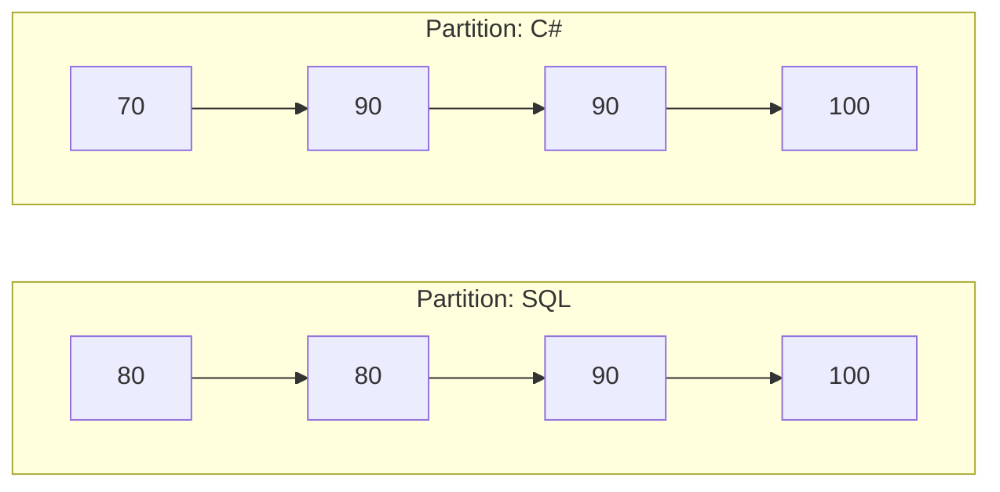

LAG/LEAD never look across the boxes: the first row of each partition has `NULL` as previous, the last has `NULL` as next.

### FIRST_VALUE / LAST_VALUE

They return the first / last value of the (ordered) partition:

```sql
SELECT sname, grade, cname,
       FIRST_VALUE(sname) OVER (PARTITION BY cname ORDER BY grade) AS lowest,
       LAST_VALUE(sname)  OVER (PARTITION BY cname ORDER BY grade
            ROWS BETWEEN UNBOUNDED PRECEDING AND UNBOUNDED FOLLOWING) AS highest
FROM grades
```

> ⚠️ `LAST_VALUE` needs the `ROWS BETWEEN ...` frame. By default the frame ends at the current row, so it would just return the current row.

---

## Quick Summary

| Concept | One-line takeaway |
|---|---|
| Local variable `@x` | `DECLARE`, then `SET` / `SELECT` to assign, `SELECT @x` to display |
| Global variable `@@x` | Read-only, created by the server |
| Table variable | A variable that holds many rows |
| `EXECUTE` | Runs a string as a query → dynamic SQL |
| `IF` / `IF EXISTS` | Condition vs. existence check |
| `BEGIN ... END` | SQL's `{ }` for multi-statement bodies |
| `TRY / CATCH` | Handle errors instead of pre-checking |
| Batch / Script | Statements sent together / batches split by `GO` |
| Transaction | All-or-nothing (Atomicity), use `COMMIT` / `ROLLBACK` |
| Scalar / Inline / Multi-statement function | One value / table from a SELECT / table built with logic |
| `LAG` / `LEAD` + `PARTITION BY` | Previous / next row value, optionally per group |
