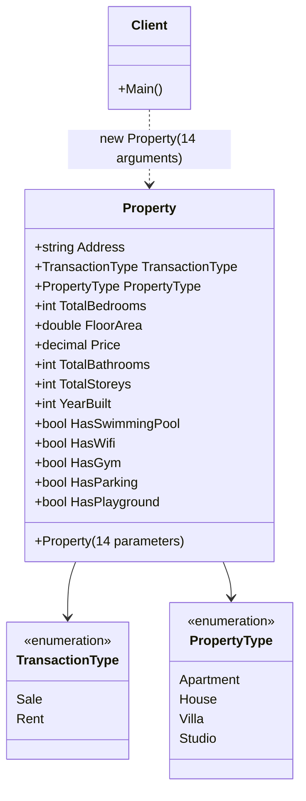
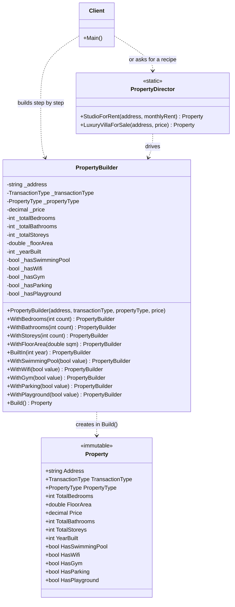
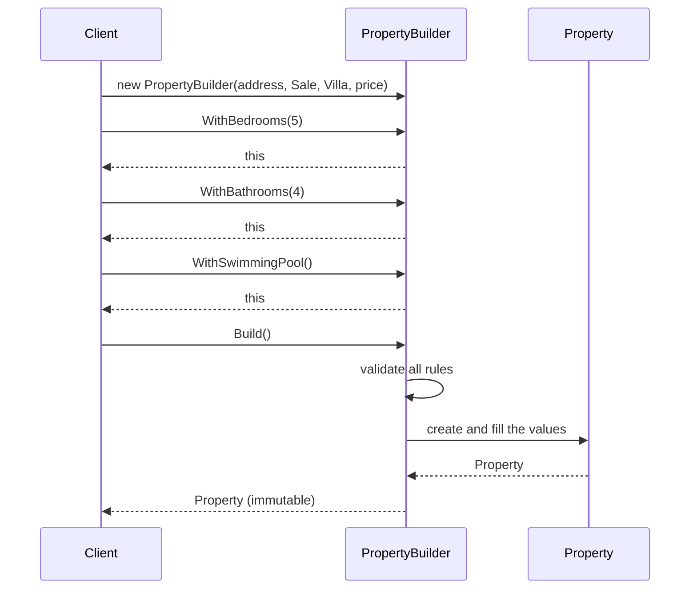

# Builder Design Pattern in C#

> **Category:** Creational pattern
> **One-line intent:** *Separate the construction of a complex object from its representation, so the same construction process can create different results, and so the object is created step by step in a readable way.*

This README explains the pattern using one example: a **`Property`** (real-estate listing) class whose constructor takes **14 parameters**, exactly like the one in the screenshot.

```
Table of contents
1. The problem (BEFORE): UML + code + what is wrong
2. The solution (AFTER): UML + code + how it works
3. Before vs After, side by side
4. Step-by-step refactoring recipe
5. Variations of the pattern
6. When to use it, when not to
7. Builder in the .NET libraries
8. Common mistakes
9. Exercises
```

> **Note about the screenshot:** it shows the 5 `bool` properties and the constructor with its 14 parameters. The properties that are not visible (`Address`, `Price`, ...) and the two enums (`TransactionType`, `PropertyType`) were rebuilt from the constructor parameters. Everything in this README was compiled and run (.NET 8).

---

# 1. The problem (BEFORE)

## 1.1 The situation

A `Property` has **9 "core" values** and **5 yes/no features**. The only way to create one is a constructor that receives **everything**:

```csharp
public Property(
    string address, TransactionType transactionType, PropertyType propertyType,
    int totalBedrooms, double floorArea, decimal price, int totalBathrooms,
    int totalStoreys, int yearBuilt, bool hasSwimmingPool, bool hasWifi,
    bool hasGym, bool hasParking, bool hasPlayground)
```

This smell has a name: the **telescoping constructor** (or "constructor with too many parameters").

## 1.2 UML: BEFORE



Text version (for viewers that do not render Mermaid):

```
┌────────┐   new Property(a1, a2, ... a14)   ┌──────────────────────────┐
│ Client │ ────────────────────────────────► │ Property                 │
└────────┘                                   │  + 14 get/set properties │
                                             │  + Property(14 params)   │
                                             └──────────────────────────┘
The client must know the order, the type and the meaning of all 14 arguments.
```

## 1.3 Code: BEFORE

```csharp
using System;
using System.Linq;

namespace BuilderPattern.Before
{
    public enum TransactionType { Sale, Rent }
    public enum PropertyType { Apartment, House, Villa, Studio }

    public class Property
    {
        public string Address { get; set; }
        public TransactionType TransactionType { get; set; }
        public PropertyType PropertyType { get; set; }
        public int TotalBedrooms { get; set; }
        public double FloorArea { get; set; }
        public decimal Price { get; set; }
        public int TotalBathrooms { get; set; }
        public int TotalStoreys { get; set; }
        public int YearBuilt { get; set; }
        public bool HasSwimmingPool { get; set; }
        public bool HasWifi { get; set; }
        public bool HasGym { get; set; }
        public bool HasParking { get; set; }
        public bool HasPlayground { get; set; }

        public Property(
            string address, TransactionType transactionType, PropertyType propertyType,
            int totalBedrooms, double floorArea, decimal price, int totalBathrooms,
            int totalStoreys, int yearBuilt, bool hasSwimmingPool, bool hasWifi,
            bool hasGym, bool hasParking, bool hasPlayground)
        {
            Address = address;
            TransactionType = transactionType;
            PropertyType = propertyType;
            TotalBedrooms = totalBedrooms;
            FloorArea = floorArea;
            Price = price;
            TotalBathrooms = totalBathrooms;
            TotalStoreys = totalStoreys;
            YearBuilt = yearBuilt;
            HasSwimmingPool = hasSwimmingPool;
            HasWifi = hasWifi;
            HasGym = hasGym;
            HasParking = hasParking;
            HasPlayground = hasPlayground;
        }

        public override string ToString()
        {
            var features = new[]
            {
                HasSwimmingPool ? "pool" : null, HasWifi ? "wifi" : null, HasGym ? "gym" : null,
                HasParking ? "parking" : null, HasPlayground ? "playground" : null
            }.Where(f => f != null);

            return $"{PropertyType} for {TransactionType} | {Address} | {Price:N0} | " +
                   $"{TotalBedrooms} bed, {TotalBathrooms} bath, {TotalStoreys} storey(s) | " +
                   $"{FloorArea} m2 | built {YearBuilt} | features: {string.Join(", ", features)}";
        }
    }
}
```

### The client code (BEFORE)

```csharp
// 14 arguments: which "true" is the gym? which "2" is the storeys?
var villa = new Property(
    "12 Palm Street, Cairo", TransactionType.Sale, PropertyType.Villa,
    5, 420.5, 9_500_000m, 4,
    2, 2019, true, true,
    true, true, false);

// A small studio still has to pass ALL 14 values
var studio = new Property(
    "5 Nile Corniche, Giza", TransactionType.Rent, PropertyType.Studio,
    1, 35, 8_000m, 1,
    1, 2015, false, true,
    false, false, false);

// A silent bug: bathrooms and storeys swapped (both are int), and it STILL compiles
var wrong = new Property(
    "12 Palm Street, Cairo", TransactionType.Sale, PropertyType.Villa,
    5, 420.5, 9_500_000m, 2,
    4, 2019, true, true,
    true, true, false);
```

Output:

```
Villa for Sale | 12 Palm Street, Cairo | 9,500,000 | 5 bed, 4 bath, 2 storey(s) | 420.5 m2 | built 2019 | features: pool, wifi, gym, parking
Studio for Rent | 5 Nile Corniche, Giza | 8,000 | 1 bed, 1 bath, 1 storey(s) | 35 m2 | built 2015 | features: wifi
Villa for Sale | 12 Palm Street, Cairo | 9,500,000 | 5 bed, 2 bath, 4 storey(s) | 420.5 m2 | built 2019 | features: pool, wifi, gym, parking
```

Look at the third line: it has `2 bath, 4 storey(s)` instead of `4 bath, 2 storey(s)`. The data is wrong and there was **no error at all**.

## 1.4 What is wrong?

| # | Problem | Example from the code above |
|---|---|---|
| 1 | **Unreadable call site.** The reader sees values, not meanings. | `..., 1, 2015, false, true, false, false, false` What is each one? |
| 2 | **Swapped arguments compile silently.** Several parameters share the same type (`int` ×4, `bool` ×5). | `totalBathrooms` and `totalStoreys` can be swapped without any error (the `wrong` villa). |
| 3 | **No optional values.** Every caller must supply all 14, even for defaults like "no playground". | The studio has to write `false, false, false`. |
| 4 | **Fragile to change.** Adding `HasElevator` means a 15th parameter and **every** existing call breaks. | All `new Property(...)` in the code base stop compiling. |
| 5 | **Validation has no home.** Where do you reject a negative price or an empty address? In the constructor (that grows even more), or nowhere. | `new Property("", ..., -5m, ...)` is accepted. |
| 6 | **Mutable after creation.** Public `set` lets anyone change the object into an invalid state later. | `villa.Price = -1;` compiles. |
| 7 | **Hard to test and to read.** Tests repeat 14 arguments again and again. | Every unit test has a wall of values. |

The usual "quick fixes" are not enough:

| Quick fix | Why it falls short |
|---|---|
| Many constructor **overloads** | Explodes: 2^5 combinations for the 5 features alone. |
| **Optional parameters** (`bool hasWifi = false`) | Better, but you can still mix up the `int`s, and there is still no place for validation. |
| **Object initializer** (`new Property { ... }`) | Needs public setters (mutable), and nothing forces required values or validates the whole object. |
| **Named arguments** | Helps readability, but the callers must remember to use them. Nothing enforces it. |

---

# 2. The solution (AFTER): the Builder pattern

## 2.1 The idea

Move the construction out of the constructor into a separate **builder** object:

1. The client **starts** a builder with the values that are truly required.
2. The client **adds only the options it wants**, one named step at a time (`.WithWifi()`, `.WithBedrooms(5)`).
3. The client calls **`Build()`**. The builder **validates** everything and returns a finished, **immutable** `Property`.

The result reads like a sentence, and each value has a name.

## 2.2 The participants

| Role in the pattern | Class in this example | Responsibility |
|---|---|---|
| **Product** | `Property` | The complex object being created. After creation it never changes. |
| **Builder** | `PropertyBuilder` | Holds the values, exposes one method per option, validates, and creates the product in `Build()`. |
| **Director** *(optional)* | `PropertyDirector` | Knows ready-made **recipes** ("luxury villa", "studio for rent") that call the builder in a fixed order. |
| **Client** | `Program` | Uses the builder directly, or asks the director for a recipe. |

## 2.3 UML: AFTER



Text version:

```
 ┌────────┐  1. new PropertyBuilder(required values)  ┌─────────────────┐
 │ Client │ ───────────────────────────────────────►  │ PropertyBuilder │
 │        │  2. .WithBedrooms(5).WithWifi() ...        │  (fluent steps) │
 │        │  3. .Build()                               └────────┬────────┘
 └───┬────┘                                                     │ validates, then creates
     │  (or asks)                                               ▼
     │        ┌──────────────────┐  uses the builder   ┌────────────────┐
     └──────► │ PropertyDirector │ ──────────────────► │ Property       │
              │  ready recipes   │                     │  (immutable)   │
              └──────────────────┘                     └────────────────┘
```

### Sequence of calls



## 2.4 Code: AFTER

### `Property.cs` (the product: immutable, no 14-parameter constructor)

```csharp
using System;
using System.Linq;

namespace BuilderPattern.After
{
    public enum TransactionType { Sale, Rent }
    public enum PropertyType { Apartment, House, Villa, Studio }

    public class Property
    {
        // "init" = can be set while the object is being created, never afterwards
        public string Address { get; init; }
        public TransactionType TransactionType { get; init; }
        public PropertyType PropertyType { get; init; }
        public int TotalBedrooms { get; init; }
        public double FloorArea { get; init; }
        public decimal Price { get; init; }
        public int TotalBathrooms { get; init; }
        public int TotalStoreys { get; init; }
        public int YearBuilt { get; init; }
        public bool HasSwimmingPool { get; init; }
        public bool HasWifi { get; init; }
        public bool HasGym { get; init; }
        public bool HasParking { get; init; }
        public bool HasPlayground { get; init; }

        // "internal": code outside this assembly cannot call it; only the builder creates properties
        internal Property() { }

        public override string ToString()
        {
            var features = new[]
            {
                HasSwimmingPool ? "pool" : null, HasWifi ? "wifi" : null, HasGym ? "gym" : null,
                HasParking ? "parking" : null, HasPlayground ? "playground" : null
            }.Where(f => f != null);

            return $"{PropertyType} for {TransactionType} | {Address} | {Price:N0} | " +
                   $"{TotalBedrooms} bed, {TotalBathrooms} bath, {TotalStoreys} storey(s) | " +
                   $"{FloorArea} m2 | built {YearBuilt} | features: {string.Join(", ", features)}";
        }
    }
}
```

### `PropertyBuilder.cs` (the builder)

```csharp
using System;

namespace BuilderPattern.After
{
    public class PropertyBuilder
    {
        // required: must be given to start building
        private readonly string _address;
        private readonly TransactionType _transactionType;
        private readonly PropertyType _propertyType;
        private readonly decimal _price;

        // optional: with sensible defaults
        private int _totalBedrooms = 1;
        private int _totalBathrooms = 1;
        private int _totalStoreys = 1;
        private double _floorArea = 0;
        private int _yearBuilt = DateTime.Now.Year;
        private bool _hasSwimmingPool;
        private bool _hasWifi;
        private bool _hasGym;
        private bool _hasParking;
        private bool _hasPlayground;

        public PropertyBuilder(string address, TransactionType transactionType,
                               PropertyType propertyType, decimal price)
        {
            _address = address;
            _transactionType = transactionType;
            _propertyType = propertyType;
            _price = price;
        }

        // Every step sets ONE value and returns "this" so the calls can be chained (fluent interface)
        public PropertyBuilder WithBedrooms(int count)   { _totalBedrooms = count;  return this; }
        public PropertyBuilder WithBathrooms(int count)  { _totalBathrooms = count; return this; }
        public PropertyBuilder WithStoreys(int count)    { _totalStoreys = count;   return this; }
        public PropertyBuilder WithFloorArea(double sqm) { _floorArea = sqm;        return this; }
        public PropertyBuilder BuiltIn(int year)         { _yearBuilt = year;       return this; }

        public PropertyBuilder WithSwimmingPool(bool value = true) { _hasSwimmingPool = value; return this; }
        public PropertyBuilder WithWifi(bool value = true)         { _hasWifi = value;         return this; }
        public PropertyBuilder WithGym(bool value = true)          { _hasGym = value;          return this; }
        public PropertyBuilder WithParking(bool value = true)      { _hasParking = value;      return this; }
        public PropertyBuilder WithPlayground(bool value = true)   { _hasPlayground = value;   return this; }

        public Property Build()
        {
            // ONE place for all the validation rules
            if (string.IsNullOrWhiteSpace(_address))
                throw new InvalidOperationException("Address is required.");
            if (_price <= 0)
                throw new InvalidOperationException("Price must be greater than zero.");
            if (_totalBedrooms < 0 || _totalBathrooms < 0)
                throw new InvalidOperationException("Bedrooms and bathrooms cannot be negative.");
            if (_totalStoreys < 1)
                throw new InvalidOperationException("A property needs at least one storey.");
            if (_floorArea < 0)
                throw new InvalidOperationException("Floor area cannot be negative.");
            if (_yearBuilt < 1800 || _yearBuilt > DateTime.Now.Year)
                throw new InvalidOperationException($"Year built must be between 1800 and {DateTime.Now.Year}.");

            // A NEW product every time, so one builder can be reused safely
            return new Property
            {
                Address = _address,
                TransactionType = _transactionType,
                PropertyType = _propertyType,
                Price = _price,
                TotalBedrooms = _totalBedrooms,
                TotalBathrooms = _totalBathrooms,
                TotalStoreys = _totalStoreys,
                FloorArea = _floorArea,
                YearBuilt = _yearBuilt,
                HasSwimmingPool = _hasSwimmingPool,
                HasWifi = _hasWifi,
                HasGym = _hasGym,
                HasParking = _hasParking,
                HasPlayground = _hasPlayground
            };
        }
    }
}
```

### `PropertyDirector.cs` (optional: ready-made recipes)

```csharp
namespace BuilderPattern.After
{
    public static class PropertyDirector
    {
        public static Property StudioForRent(string address, decimal monthlyRent) =>
            new PropertyBuilder(address, TransactionType.Rent, PropertyType.Studio, monthlyRent)
                .WithFloorArea(35)
                .WithWifi()
                .Build();

        public static Property LuxuryVillaForSale(string address, decimal price) =>
            new PropertyBuilder(address, TransactionType.Sale, PropertyType.Villa, price)
                .WithBedrooms(5).WithBathrooms(4).WithStoreys(2)
                .WithFloorArea(450)
                .WithSwimmingPool().WithWifi().WithGym().WithParking().WithPlayground()
                .Build();
    }
}
```

### `Program.cs` (the client, AFTER)

```csharp
// Every value has a name: no guessing
var villa = new PropertyBuilder("12 Palm Street, Cairo", TransactionType.Sale, PropertyType.Villa, 9_500_000m)
    .WithBedrooms(5)
    .WithBathrooms(4)
    .WithStoreys(2)
    .WithFloorArea(420.5)
    .BuiltIn(2019)
    .WithSwimmingPool()
    .WithWifi()
    .WithGym()
    .WithParking()
    .Build();

// A small studio states only what it has
var studio = new PropertyBuilder("5 Nile Corniche, Giza", TransactionType.Rent, PropertyType.Studio, 8_000m)
    .WithFloorArea(35)
    .BuiltIn(2015)
    .WithWifi()
    .Build();

// Director recipes: the whole construction in one call
var quick = PropertyDirector.LuxuryVillaForSale("7 Garden City, Cairo", 12_000_000m);
var rent  = PropertyDirector.StudioForRent("3 Zamalek Street, Cairo", 9_500m);

// Validation lives in Build()
try
{
    new PropertyBuilder("", TransactionType.Sale, PropertyType.House, -5m).Build();
}
catch (InvalidOperationException ex)
{
    Console.WriteLine("Rejected: " + ex.Message);       // Rejected: Address is required.
}

// One builder can produce variations, because Build() creates a new object each time
var baseBuilder = new PropertyBuilder("1 Tahrir Square, Cairo", TransactionType.Rent, PropertyType.Apartment, 15_000m)
    .WithBedrooms(2).WithBathrooms(1).WithFloorArea(95).WithWifi();
var plain   = baseBuilder.Build();
var withGym = baseBuilder.WithGym().Build();

// Immutable: this line does not compile
// villa.Price = 1;   // error CS8852: Init-only property can only be assigned in an object initializer
```

Output:

```
Villa for Sale | 12 Palm Street, Cairo | 9,500,000 | 5 bed, 4 bath, 2 storey(s) | 420.5 m2 | built 2019 | features: pool, wifi, gym, parking
Studio for Rent | 5 Nile Corniche, Giza | 8,000 | 1 bed, 1 bath, 1 storey(s) | 35 m2 | built 2015 | features: wifi
Villa for Sale | 7 Garden City, Cairo | 12,000,000 | 5 bed, 4 bath, 2 storey(s) | 450 m2 | built 2026 | features: pool, wifi, gym, parking, playground
Studio for Rent | 3 Zamalek Street, Cairo | 9,500 | 1 bed, 1 bath, 1 storey(s) | 35 m2 | built 2026 | features: wifi
Rejected: Address is required.
Apartment for Rent | 1 Tahrir Square, Cairo | 15,000 | 2 bed, 1 bath, 1 storey(s) | 95 m2 | built 2026 | features: wifi
Apartment for Rent | 1 Tahrir Square, Cairo | 15,000 | 2 bed, 1 bath, 1 storey(s) | 95 m2 | built 2026 | features: wifi, gym
```

(`built 2026` is the default: the current year, because no `BuiltIn(...)` was called.)

## 2.5 How it works, step by step

1. **`new PropertyBuilder(address, type, propertyType, price)`**: the four values that every property must have go in the **builder's constructor**. You cannot even start building without them.
2. **`.WithBedrooms(5)`**: stores the value in a private field and **returns `this`**. Returning the same builder is what lets you chain calls (a *fluent interface*).
3. **Defaults**: anything the client does not mention keeps its default (1 bedroom, 1 bathroom, no wifi...). That is why the studio does not need `false, false, false`.
4. **`.Build()`**: the single exit door. It checks **all** the rules, then creates the `Property` with an object initializer.
5. **`init` properties**: the product can be filled while it is created but never changed afterwards, so an invalid or half-built `Property` can never exist.
6. **`internal` constructor**: in a real solution, put `Property` and `PropertyBuilder` in a **class library**. Other projects then cannot call `new Property()` and must go through the builder. (In a single-project demo this is only a convention.)
7. **Director**: if the same sequence of steps is used again and again, give it a name and put it in one place.

---

# 3. Before vs After, side by side

## The call site

```csharp
// BEFORE                                          // AFTER
var studio = new Property(                         var studio = new PropertyBuilder(
    "5 Nile Corniche, Giza",                           "5 Nile Corniche, Giza",
    TransactionType.Rent,                              TransactionType.Rent,
    PropertyType.Studio,                               PropertyType.Studio,
    1, 35, 8_000m, 1,                                  8_000m)
    1, 2015,                                           .WithFloorArea(35)
    false, true, false, false, false);                 .BuiltIn(2015)
                                                       .WithWifi()
                                                       .Build();
```

## The comparison

| Aspect | Before (long constructor) | After (Builder) |
|---|---|---|
| Readability | Values without names | Every value has a name (`WithBathrooms(4)`) |
| Swapped arguments | Compile silently | Impossible: each value has its own method |
| Optional values | Must pass all 14 | Mention only what you need; the rest are defaults |
| Adding a new feature | Breaks every caller | Add one method; existing code keeps working |
| Validation | Nowhere (or in the bloated constructor) | One place: `Build()` |
| Object state | Mutable (`set`), can become invalid later | Immutable (`init`), always valid |
| Ready-made recipes | Copy and paste 14 arguments | `PropertyDirector.LuxuryVillaForSale(...)` |
| Amount of code | Less | **More** (a builder class); worth it only when the object is complex |

---

# 4. Step-by-step refactoring recipe

Use this recipe on any class that looks like the one in the screenshot.

| Step | Action | In this example |
|---|---|---|
| 1 | List the constructor parameters. Split them into **required** and **optional**. | Required: address, transaction type, property type, price. Optional: the rest. |
| 2 | Create a `XxxBuilder` class with **one private field per parameter**. Put the required ones in the builder's constructor. | `PropertyBuilder(address, transactionType, propertyType, price)` |
| 3 | For each optional value add a method **named by intent** that stores the value and **returns `this`**. | `WithWifi()`, `WithBedrooms(5)`, `BuiltIn(2019)` |
| 4 | Move validation into a **`Build()`** method. | The `if (...) throw` block |
| 5 | Make the product **immutable**: change `set` to `init`, delete the long constructor, make the remaining constructor `internal`. | `public string Address { get; init; }` |
| 6 | Replace every `new Xxx(...)` with the builder. Compile: the compiler lists all the places to update. | |
| 7 | *(Optional)* Add a **director** for the combinations you create repeatedly. | `PropertyDirector` |

---

# 5. Variations of the pattern

## 5.1 Classic GoF structure (with an interface)

The textbook version has an **abstract builder** so the same director can build **different kinds** of products:

```
Director ──uses──► IBuilder ◄──implements── ConcreteBuilderA ──creates──► ProductA
                      ▲
                      └─────────implements── ConcreteBuilderB ──creates──► ProductB
```

| GoF name | Typical meaning | In the fluent version above |
|---|---|---|
| `Builder` (interface) | `SetAddress()`, `SetPrice()`, `GetResult()` | Not needed: there is only one kind of product |
| `ConcreteBuilder` | Implements the steps for one product | `PropertyBuilder` |
| `Director` | Calls the steps in a fixed order | `PropertyDirector` (optional) |
| `Product` | The result | `Property` |

Use the interface version when you need **several builders that create different representations** (for example `PropertyBuilder` and `PropertyReportBuilder` that both consume the same director steps and produce an object and a PDF).

## 5.2 Other common variations

| Variation | What it adds |
|---|---|
| **Nested builder** (`Property.Builder`) | The builder is a class **inside** `Property`, so it can use `private` setters and a `private` constructor. Strong privacy even inside one project (the Java style). |
| **Step builder** | Each step returns a **different interface**, so the compiler forces the order and the required values (`.WithAddress().WithPrice().Build()`). |
| **`ToBuilder()` / copy builder** | `existing.ToBuilder().WithPrice(8_000_000m).Build()` creates a modified copy of an immutable object. |
| **`record` + `with`** | For simple immutable data, `var cheaper = villa with { Price = 8_000_000m };` may be enough (no builder class). |
| **Builder with a result type** | `Build()` returns `Result<Property>` with validation errors instead of throwing. |

---

# 6. When to use it, when not to

| Use the Builder when... | Do **not** use it when... |
|---|---|
| The constructor has **4 or more parameters**, especially optional ones | The class has 2 or 3 simple fields |
| Several parameters have the **same type** (easy to swap) | A constructor with named arguments is already clear |
| You need **validation of the whole object** before it exists | The class is a simple data holder (use a `record`) |
| The same construction steps produce **different variants** | There is only one way to create it, and it never changes |
| The product should be **immutable** | You would just copy every property into a builder with no benefit (over-engineering) |
| Construction has **many steps** or must happen in stages | |

**Rule of thumb:** if you see a constructor call you cannot read without hovering over every argument, you probably want a builder.

### Builder vs similar patterns

| Pattern | Focus |
|---|---|
| **Builder** | **How** a complex object is assembled, step by step |
| **Factory Method / Abstract Factory** | **Which** class to instantiate; the object is usually created in one call |
| **Prototype** | Create objects by **copying** an existing one |
| **Object initializer / `record with`** | Language features for simple cases |

---

# 7. Builder in the .NET libraries

You already use this pattern:

| Class | Example |
|---|---|
| `StringBuilder` | `new StringBuilder().Append("a").Append("b").ToString()` |
| `UriBuilder` | Builds a URL part by part |
| `SqlConnectionStringBuilder` | Sets `DataSource`, `InitialCatalog`... then `ConnectionString` |
| `WebApplication.CreateBuilder(args)` | ASP.NET Core: configure services, then `builder.Build()` |
| `Host.CreateDefaultBuilder(args)` | Generic host: `.ConfigureServices(...).Build()` |
| `ConfigurationBuilder` | `.AddJsonFile(...).AddEnvironmentVariables().Build()` |
| `DbContextOptionsBuilder` / `ModelBuilder` | Entity Framework Core configuration |

Notice the same shape everywhere: **create builder → fluent configuration → `Build()` (or `ToString()`)**.

---

# 8. Common mistakes

| Mistake | Why it hurts | Fix |
|---|---|---|
| Forgetting to call `Build()` | You hold a builder, not a product | Return type of `Build()` is the product, so the compiler complains when you use it as one |
| Reusing one builder and being surprised | The builder is **mutable**: `baseBuilder.WithGym()` changes it for all later builds | Create a new builder, or add a `ToBuilder()`/copy method |
| Validating in each `WithX` method only | Rules that involve **several** values cannot be checked | Validate in `Build()` (you can do both) |
| Keeping the product mutable | Any code can break the invariants later | `init` / get-only properties |
| Public constructor on the product | Clients bypass the builder | `internal` or `private` constructor, or a nested builder |
| Builder methods that return `void` | Chaining breaks | Return `this` |
| Putting business logic in the director | The director becomes a second builder | Directors only **sequence** builder calls |
| Using a builder for a 3-field class | More code, no benefit | Constructor or `record` |

---

# 9. Exercises

1. **Add a feature.** Add `HasElevator` to `Property` and `WithElevator()` to the builder. Check that **no existing client code** has to change. (Compare with the long constructor, where all callers break.)
2. **New rule.** In `Build()`, reject a `Villa` with `TotalStoreys < 2`, and a `Studio` with more than 1 bedroom.
3. **New recipe.** Add `PropertyDirector.FamilyHouseForSale(address, price)` (3 bedrooms, 2 bathrooms, parking, playground).
4. **Copy builder.** Add `Property.ToBuilder()` so that `villa.ToBuilder().WithPrice(...)` creates a modified copy. (Hint: the builder needs a `WithPrice` method and a way to start from an existing property.)
5. **Prove the safety.** In the "before" code, swap two `int` arguments and show that it compiles. Then try the same mistake with the builder.
6. **Step builder (harder).** Make `Build()` available only after the address and the price have been set, enforced by the compiler.
7. **Tests.** Write 4 unit tests: valid build, missing address, negative price, builder reuse creates two different objects.

---

# Summary

| | |
|---|---|
| **Problem** | A class with a huge constructor (`Property` with 14 parameters): unreadable, error-prone, no validation, hard to extend. |
| **Solution** | A **builder** collects the values one named step at a time and creates the finished object in `Build()`. |
| **Parts** | Product (`Property`), Builder (`PropertyBuilder`), optional Director (`PropertyDirector`), Client. |
| **Gains** | Readable code, no swapped arguments, optional values with defaults, one place for validation, immutable objects, easy to extend. |
| **Cost** | One extra class to write and maintain. Worth it for complex objects, not for simple ones. |
