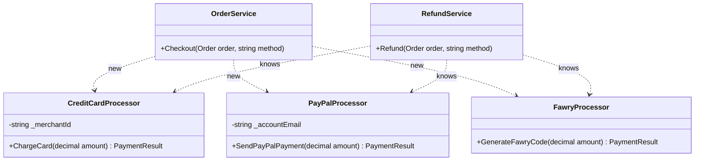
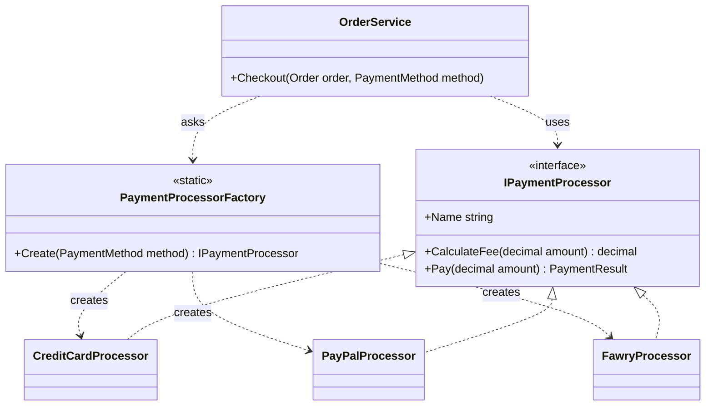
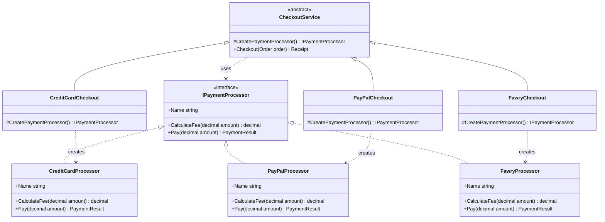
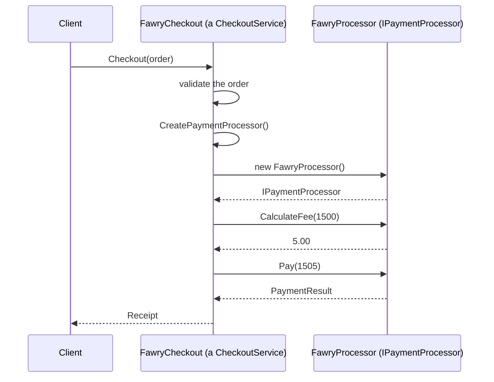
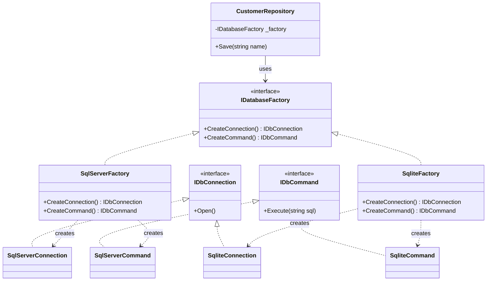

# Factory Design Patterns in C#

> **Category:** Creational patterns
> **One-line intent:** *Move the decision "which concrete class do I create?" out of the code that uses the object, so the client depends on an **interface** and not on `new ConcreteClass()`.*

This README uses one running example: an online shop that accepts **several payment methods** (credit card, PayPal, Fawry, and later Vodafone Cash).

```
Table of contents
1. What "Factory" means (three different patterns)
2. The problem (BEFORE): UML + code + what is wrong
3. Step 1: a common interface + Simple Factory (a quick win)
4. Step 2: the Factory Method pattern (the GoF pattern): UML + code + explanation
5. Abstract Factory (families of objects): UML + code
6. Before vs After, side by side
7. Step-by-step refactoring recipe
8. When to use which, and when not to
9. Factories in .NET
10. Common mistakes
11. Exercises
```

> Everything in this README (all code and all outputs) was compiled and run on .NET 8.

---

# 1. What "Factory" means

"Factory" is used for **three** related things. They are often mixed up, so learn the difference first.

| Name | What it is | A GoF pattern? | Core idea |
|---|---|---|---|
| **Simple Factory** | One class (often `static`) with a method that returns the right object, usually using `switch` | **No** (it is an idiom) | "Put all the `new` calls in one place" |
| **Factory Method** | A method (`CreateX()`) declared in a base class and **overridden in subclasses** to decide what to create | **Yes** | "Let subclasses decide which class to instantiate" |
| **Abstract Factory** | An **interface** with several `CreateX()` / `CreateY()` methods that create a **family** of related objects | **Yes** | "Create matching sets of objects without naming their classes" |

```
Simple Factory    :  one switch, one place, returns a product
Factory Method    :  inheritance: the SUBCLASS chooses the product
Abstract Factory  :  composition: a factory object creates a WHOLE FAMILY of products
```

All three share the same goal: the code that **uses** an object must not know **which concrete class** it is.

---

# 2. The problem (BEFORE)

## 2.1 The situation

The shop's `OrderService` has to take a payment. The payment methods are three **unrelated classes**, and `OrderService` creates them itself:

```csharp
if (method == "card")
{
    var processor = new CreditCardProcessor("MERCHANT-123");
    result = processor.ChargeCard(order.Total);
}
else if (method == "paypal")
{
    var processor = new PayPalProcessor("shop@example.com");
    result = processor.SendPayPalPayment(order.Total);
}
else if (method == "fawry") { ... }
```

## 2.2 UML: BEFORE



Text version:

```
┌──────────────┐   if/else + new   ┌──────────────────────┐
│ OrderService │ ────────────────► │ CreditCardProcessor  │  ChargeCard()
│              │ ────────────────► │ PayPalProcessor      │  SendPayPalPayment()
└──────────────┘ ────────────────► │ FawryProcessor       │  GenerateFawryCode()
┌──────────────┐                   └──────────────────────┘
│RefundService │  the same if/else chain, copied again
└──────────────┘
```

## 2.3 Code: BEFORE

```csharp
namespace FactoryPattern.Before
{
    public record Order(int Id, string Customer, decimal Total);
    public record PaymentResult(bool Success, string Reference, string Message);

    // Three unrelated classes: no common interface, even the method names differ
    public class CreditCardProcessor
    {
        private readonly string _merchantId;
        public CreditCardProcessor(string merchantId) => _merchantId = merchantId;
        public PaymentResult ChargeCard(decimal amount) =>
            new(true, $"CC-{_merchantId}-{amount:0}", $"Charged {amount:N2} to the credit card");
    }

    public class PayPalProcessor
    {
        private readonly string _accountEmail;
        public PayPalProcessor(string accountEmail) => _accountEmail = accountEmail;
        public PaymentResult SendPayPalPayment(decimal amount) =>
            new(true, $"PP-{_accountEmail}-{amount:0}", $"Sent {amount:N2} through PayPal");
    }

    public class FawryProcessor
    {
        public PaymentResult GenerateFawryCode(decimal amount) =>
            new(true, $"FW-{(int)amount * 7}", $"Pay {amount:N2} at any Fawry kiosk with this code");
    }

    public class OrderService
    {
        public void Checkout(Order order, string method)
        {
            PaymentResult result;

            // the object creation and the choice of class are mixed into the business logic
            if (method == "card")
            {
                var processor = new CreditCardProcessor("MERCHANT-123");
                result = processor.ChargeCard(order.Total);
            }
            else if (method == "paypal")
            {
                var processor = new PayPalProcessor("shop@example.com");
                result = processor.SendPayPalPayment(order.Total);
            }
            else if (method == "fawry")
            {
                var processor = new FawryProcessor();
                result = processor.GenerateFawryCode(order.Total);
            }
            else
            {
                throw new ArgumentException($"Unknown payment method: {method}");
            }

            Console.WriteLine($"Order {order.Id} ({order.Customer}): {result.Message} [{result.Reference}]");
        }
    }

    public class RefundService
    {
        public void Refund(Order order, string method)
        {
            // the SAME if/else chain is copied here
            if (method == "card")
                Console.WriteLine($"Refund {order.Total:N2} to the credit card of {order.Customer}");
            else if (method == "paypal")
                Console.WriteLine($"Refund {order.Total:N2} to the PayPal account of {order.Customer}");
            else if (method == "fawry")
                Console.WriteLine($"Refund {order.Total:N2} in cash at a Fawry kiosk for {order.Customer}");
            else
                throw new ArgumentException($"Unknown payment method: {method}");
        }
    }
}
```

Client:

```csharp
var order = new Order(1001, "Mona", 1500m);
var orders = new OrderService();

orders.Checkout(order, "card");
orders.Checkout(order, "paypal");
orders.Checkout(order, "fawry");

try { orders.Checkout(order, "vodafone-cash"); }
catch (ArgumentException ex) { Console.WriteLine("Error: " + ex.Message); }

new RefundService().Refund(order, "paypal");
```

Output:

```
Order 1001 (Mona): Charged 1,500.00 to the credit card [CC-MERCHANT-123-1500]
Order 1001 (Mona): Sent 1,500.00 through PayPal [PP-shop@example.com-1500]
Order 1001 (Mona): Pay 1,500.00 at any Fawry kiosk with this code [FW-10500]
Error: Unknown payment method: vodafone-cash
Refund 1,500.00 to the PayPal account of Mona
```

## 2.4 What is wrong?

| # | Problem | Where you see it |
|---|---|---|
| 1 | **Tight coupling to concrete classes.** `OrderService` references three concrete processors. | `new CreditCardProcessor(...)` inside `Checkout` |
| 2 | **Violates the Open/Closed Principle.** Adding Vodafone Cash means **editing** `OrderService` (and `RefundService`). Code that already works must be reopened and re-tested. | A new `else if` in two classes |
| 3 | **Duplicated decision logic.** The same `if/else` chain is copied into several classes. Forget one and you get a bug. | `Checkout` and `Refund` |
| 4 | **No common interface.** The classes do the same job but have different method names (`ChargeCard`, `SendPayPalPayment`, `GenerateFawryCode`), so you cannot treat them uniformly. | Three different call styles |
| 5 | **Single Responsibility is broken.** `OrderService` handles the order **and** knows how to build every gateway object (merchant ids, e-mail accounts...). | Configuration values inside business code |
| 6 | **Impossible to unit test.** You cannot replace the real gateway with a fake, so a test would call the real service. | `new` is hard-wired |
| 7 | **Magic strings.** `"card"`, `"paypal"`: a typo compiles and fails only at run time. | `method == "paypal"` |

---

# 3. Step 1: a common interface + Simple Factory

Two changes, both easy and both valuable.

## 3.1 Change A: introduce a common interface (the "product")

The three processors do the same thing, so give them one **contract**:

```csharp
public interface IPaymentProcessor
{
    string Name { get; }
    decimal CalculateFee(decimal amount);
    PaymentResult Pay(decimal amount);
}
```

> This interface is the heart of **every** factory pattern. A factory only makes sense when the products share a type that the client can use without knowing the concrete class.

## 3.2 Change B: move all `new` calls into one place

```csharp
public enum PaymentMethod { CreditCard, PayPal, Fawry }   // an enum instead of magic strings

public static class PaymentProcessorFactory
{
    public static IPaymentProcessor Create(PaymentMethod method) => method switch
    {
        PaymentMethod.CreditCard => new CreditCardProcessor("MERCHANT-123"),
        PaymentMethod.PayPal     => new PayPalProcessor("shop@example.com"),
        PaymentMethod.Fawry      => new FawryProcessor(),
        _ => throw new ArgumentOutOfRangeException(nameof(method), method, "Unknown payment method")
    };
}
```

The service becomes:

```csharp
public class OrderService
{
    public void Checkout(Order order, PaymentMethod method)
    {
        IPaymentProcessor processor = PaymentProcessorFactory.Create(method);   // one line, no if/else
        var result = processor.Pay(order.Total);
        Console.WriteLine($"Order {order.Id}: {result.Message} (fee {processor.CalculateFee(order.Total):N2}) [{result.Reference}]");
    }
}
```

Output:

```
Order 1001: Charged 1,500.00 to the credit card (fee 38.50) [CC-MERCHANT-123-1500]
Order 1001: Sent 1,500.00 through PayPal (fee 51.30) [PP-shop@example.com-1500]
Order 1001: Pay 1,500.00 at any Fawry kiosk with this code (fee 5.00) [FW-10500]
```

## 3.3 UML: Simple Factory



## 3.4 What improved, and what is still missing

| Fixed | Still a problem |
|---|---|
| One place decides which class to create | The `switch` is still **edited** for each new payment method (Open/Closed not fully solved) |
| Client depends on `IPaymentProcessor` | `static` factory cannot be replaced in a test |
| No duplicated `if/else` chains | The factory knows **every** concrete class and its configuration |
| Enum instead of magic strings | A single "god factory" grows with the product line |

Simple Factory is often **good enough**. When it is not, use the next step.

---

# 4. Step 2: the Factory Method pattern

## 4.1 The idea

Instead of one big `switch`, create a **base class** that contains the shared business logic and declares an **abstract method** `CreatePaymentProcessor()`. Each subclass overrides that method and returns **its own** product.

```
CheckoutService (abstract)
  ├─ Checkout(order)                 ← common logic, written ONCE
  └─ CreatePaymentProcessor()        ← abstract: THE FACTORY METHOD
        ▲            ▲            ▲
CreditCardCheckout  PayPalCheckout  FawryCheckout   ← each decides the product
```

## 4.2 The participants

| Role in the pattern | Class in this example | Responsibility |
|---|---|---|
| **Product** (interface) | `IPaymentProcessor` | The contract that the creator's code uses |
| **Concrete Products** | `CreditCardProcessor`, `PayPalProcessor`, `FawryProcessor` | The real implementations |
| **Creator** (abstract) | `CheckoutService` | Contains the business logic (`Checkout`) and **declares** the factory method `CreatePaymentProcessor()` |
| **Concrete Creators** | `CreditCardCheckout`, `PayPalCheckout`, `FawryCheckout` | **Override** the factory method to return the right product |
| **Client** | `Program` | Chooses a creator and uses it through `CheckoutService` |

## 4.3 UML: Factory Method



Reading the diagram: the **left column of boxes** (products) and the **right column** (creators) are **two parallel hierarchies**. Each concrete creator is paired with one concrete product.

### Sequence of calls



The base class `CheckoutService.Checkout` runs the whole flow. The only step it does not know how to perform is **"create the processor"**, so it asks the subclass.

## 4.4 Code: AFTER (Factory Method)

```csharp
namespace FactoryPattern.FactoryMethod
{
    public enum PaymentMethod { CreditCard, PayPal, Fawry, VodafoneCash }
    public record Order(int Id, string Customer, decimal Total);
    public record PaymentResult(bool Success, string Reference, string Message);
    public record Receipt(int OrderId, string Method, decimal Amount, decimal Fee, string Reference, string Message)
    {
        public decimal GrandTotal => Amount + Fee;
    }

    // ---------- PRODUCT ----------
    public interface IPaymentProcessor
    {
        string Name { get; }
        decimal CalculateFee(decimal amount);
        PaymentResult Pay(decimal amount);
    }

    // ---------- CONCRETE PRODUCTS ----------
    public class CreditCardProcessor : IPaymentProcessor
    {
        private readonly string _merchantId;
        public CreditCardProcessor(string merchantId) => _merchantId = merchantId;
        public string Name => "Credit card";
        public decimal CalculateFee(decimal amount) => Math.Round(amount * 0.025m + 1m, 2);
        public PaymentResult Pay(decimal amount) =>
            new(true, $"CC-{_merchantId}-{amount:0}", $"Charged {amount:N2} to the credit card");
    }

    public class PayPalProcessor : IPaymentProcessor
    {
        private readonly string _accountEmail;
        public PayPalProcessor(string accountEmail) => _accountEmail = accountEmail;
        public string Name => "PayPal";
        public decimal CalculateFee(decimal amount) => Math.Round(amount * 0.034m + 0.30m, 2);
        public PaymentResult Pay(decimal amount) =>
            new(true, $"PP-{_accountEmail}-{amount:0}", $"Sent {amount:N2} through PayPal");
    }

    public class FawryProcessor : IPaymentProcessor
    {
        public string Name => "Fawry";
        public decimal CalculateFee(decimal amount) => 5m;
        public PaymentResult Pay(decimal amount) =>
            new(true, $"FW-{(int)amount * 7}", $"Pay {amount:N2} at any Fawry kiosk with this code");
    }

    // ---------- CREATOR: the factory method is abstract ----------
    public abstract class CheckoutService
    {
        // THE FACTORY METHOD: subclasses decide which product to create
        protected abstract IPaymentProcessor CreatePaymentProcessor();

        // The business logic works only with the interface, never with a concrete class
        public Receipt Checkout(Order order)
        {
            if (order.Total <= 0)
                throw new ArgumentException("Order total must be greater than zero.");

            IPaymentProcessor processor = CreatePaymentProcessor();      // <-- the factory method is called here
            decimal fee = processor.CalculateFee(order.Total);
            PaymentResult result = processor.Pay(order.Total + fee);

            return new Receipt(order.Id, processor.Name, order.Total, fee, result.Reference, result.Message);
        }
    }

    // ---------- CONCRETE CREATORS ----------
    public class CreditCardCheckout : CheckoutService
    {
        protected override IPaymentProcessor CreatePaymentProcessor() => new CreditCardProcessor("MERCHANT-123");
    }

    public class PayPalCheckout : CheckoutService
    {
        protected override IPaymentProcessor CreatePaymentProcessor() => new PayPalProcessor("shop@example.com");
    }

    public class FawryCheckout : CheckoutService
    {
        protected override IPaymentProcessor CreatePaymentProcessor() => new FawryProcessor();
    }
}
```

### A new requirement: Vodafone Cash (added **without touching any existing class**)

```csharp
public class VodafoneCashProcessor : IPaymentProcessor
{
    public string Name => "Vodafone Cash";
    public decimal CalculateFee(decimal amount) => Math.Round(amount * 0.01m, 2);
    public PaymentResult Pay(decimal amount) =>
        new(true, $"VC-{(int)amount * 3}", $"Confirm {amount:N2} in your Vodafone Cash wallet");
}

public class VodafoneCashCheckout : CheckoutService
{
    protected override IPaymentProcessor CreatePaymentProcessor() => new VodafoneCashProcessor();
}
```

Two **new** classes. `CheckoutService`, `CreditCardCheckout`, `PayPalCheckout` and `FawryCheckout` are **unchanged**.

### A test double (the testability gain)

```csharp
public class FakePaymentProcessor : IPaymentProcessor
{
    public string Name => "Fake";
    public decimal CalculateFee(decimal amount) => 0m;
    public PaymentResult Pay(decimal amount) => new(true, "TEST-REF", "Fake payment, no real money moved");
}

public class TestCheckout : CheckoutService
{
    protected override IPaymentProcessor CreatePaymentProcessor() => new FakePaymentProcessor();
}
```

### The client

```csharp
var order = new Order(1001, "Mona", 1500m);

// 1) The client picks a creator; the rest of the code only knows CheckoutService
CheckoutService checkout = new FawryCheckout();
Print(checkout.Checkout(order));

// 2) Choice at run time: ONE place (the "composition root") maps the user's choice to a creator
var checkouts = new Dictionary<PaymentMethod, CheckoutService>
{
    [PaymentMethod.CreditCard]   = new CreditCardCheckout(),
    [PaymentMethod.PayPal]       = new PayPalCheckout(),
    [PaymentMethod.Fawry]        = new FawryCheckout(),
    [PaymentMethod.VodafoneCash] = new VodafoneCashCheckout(),   // the new method: one new line here
};

foreach (var method in new[] { PaymentMethod.CreditCard, PaymentMethod.PayPal, PaymentMethod.VodafoneCash })
    Print(checkouts[method].Checkout(order));

// 3) Testing: no real gateway is touched
Print(new TestCheckout().Checkout(order));

static void Print(Receipt r) =>
    Console.WriteLine($"Order {r.OrderId} | {r.Method,-13} | amount {r.Amount:N2} + fee {r.Fee:N2} = {r.GrandTotal:N2} | {r.Message} [{r.Reference}]");
```

Output:

```
Order 1001 | Fawry         | amount 1,500.00 + fee 5.00 = 1,505.00 | Pay 1,505.00 at any Fawry kiosk with this code [FW-10535]
Order 1001 | Credit card   | amount 1,500.00 + fee 38.50 = 1,538.50 | Charged 1,538.50 to the credit card [CC-MERCHANT-123-1539]
Order 1001 | PayPal        | amount 1,500.00 + fee 51.30 = 1,551.30 | Sent 1,551.30 through PayPal [PP-shop@example.com-1551]
Order 1001 | Vodafone Cash | amount 1,500.00 + fee 15.00 = 1,515.00 | Confirm 1,515.00 in your Vodafone Cash wallet [VC-4545]
Order 1001 | Fake          | amount 1,500.00 + fee 0.00 = 1,500.00 | Fake payment, no real money moved [TEST-REF]
```

## 4.5 How it works, step by step

1. **`IPaymentProcessor`** is the contract. The business logic is written against it, never against a concrete class.
2. **`CheckoutService.Checkout`** contains everything that is the **same** for every payment method (validation, fee, payment, receipt). It is written **once**.
3. The one thing that **differs** is *which processor to create*. The base class cannot know that, so it declares `CreatePaymentProcessor()` as **abstract** (the factory method).
4. Each **subclass** overrides it and returns its own processor, including any configuration (`"MERCHANT-123"`, `"shop@example.com"`).
5. At run time, `Checkout` calls `CreatePaymentProcessor()`. Because of **polymorphism**, the subclass's version runs. The base class never says `new FawryProcessor()`.
6. **Where did the `switch` go?** Somewhere the program must still map "the user chose Fawry" to a `FawryCheckout`. That mapping now lives in **one place at the edge of the program** (the dictionary, or a DI container). The business code contains no `if/else` about payment methods at all.

## 4.6 What improved

| Problem in the "before" code | Solved by |
|---|---|
| Tight coupling to concrete classes | `CheckoutService` only knows `IPaymentProcessor` |
| Open/Closed violation | New method = new classes (`VodafoneCashProcessor`, `VodafoneCashCheckout`) + one registration line; **no existing class is edited** |
| Duplicated `if/else` chains | Gone from the business classes |
| No common interface | `IPaymentProcessor` |
| Creation mixed with business logic | Creation is in the overridden method; the logic is in the base class |
| Untestable | `TestCheckout` + `FakePaymentProcessor` |
| Magic strings | `PaymentMethod` enum |

---

# 5. Abstract Factory: families of related objects

Factory Method creates **one product**. **Abstract Factory** creates a **family** of products that must **belong together**.

**Example:** a data layer that can run on SQL Server **or** SQLite. Each database needs a matching **connection** *and* **command**. Mixing a SQL Server connection with a SQLite command would be a bug. The factory guarantees that the pair always matches.

## 5.1 UML



## 5.2 Code

```csharp
// ---------- PRODUCT FAMILY: two related products ----------
public interface IDbConnection { void Open(); }
public interface IDbCommand    { void Execute(string sql); }

// Family 1: SQL Server
public class SqlServerConnection : IDbConnection
{
    public void Open() => Console.WriteLine("  [SQL Server] connection opened (TCP 1433)");
}
public class SqlServerCommand : IDbCommand
{
    public void Execute(string sql) => Console.WriteLine($"  [SQL Server] T-SQL: {sql}");
}

// Family 2: SQLite
public class SqliteConnection : IDbConnection
{
    public void Open() => Console.WriteLine("  [SQLite] file opened (app.db)");
}
public class SqliteCommand : IDbCommand
{
    public void Execute(string sql) => Console.WriteLine($"  [SQLite] SQL: {sql}");
}

// ---------- ABSTRACT FACTORY: creates a whole FAMILY ----------
public interface IDatabaseFactory
{
    IDbConnection CreateConnection();
    IDbCommand CreateCommand();
}

public class SqlServerFactory : IDatabaseFactory
{
    public IDbConnection CreateConnection() => new SqlServerConnection();
    public IDbCommand CreateCommand() => new SqlServerCommand();
}

public class SqliteFactory : IDatabaseFactory
{
    public IDbConnection CreateConnection() => new SqliteConnection();
    public IDbCommand CreateCommand() => new SqliteCommand();
}

// ---------- CLIENT: knows only the interfaces ----------
public class CustomerRepository
{
    private readonly IDatabaseFactory _factory;
    public CustomerRepository(IDatabaseFactory factory) => _factory = factory;

    public void Save(string name)
    {
        var connection = _factory.CreateConnection();
        var command = _factory.CreateCommand();      // always matches the connection's family
        connection.Open();
        command.Execute($"INSERT INTO Customers (Name) VALUES ('{name}')");
    }
}
```

Client:

```csharp
Console.WriteLine("Production:");
new CustomerRepository(new SqlServerFactory()).Save("Mona");

Console.WriteLine("Development / tests:");
new CustomerRepository(new SqliteFactory()).Save("Mona");
```

Output:

```
Production:
  [SQL Server] connection opened (TCP 1433)
  [SQL Server] T-SQL: INSERT INTO Customers (Name) VALUES ('Mona')
Development / tests:
  [SQLite] file opened (app.db)
  [SQLite] SQL: INSERT INTO Customers (Name) VALUES ('Mona')
```

(The `INSERT` text with a name pasted into the SQL is only for the demo. Real code uses parameters to avoid SQL injection.)

`CustomerRepository` is **identical** for both databases. To switch database you pass a different factory; one object change swaps the **whole family**.

## 5.3 Factory Method vs Abstract Factory

| | Factory Method | Abstract Factory |
|---|---|---|
| Creates | **One** product | A **family** of related products |
| Mechanism | **Inheritance**: a subclass overrides one method | **Composition**: you pass a factory object that has several create methods |
| Typical shape | Abstract class with `CreateX()` and a template method using it | Interface with `CreateX()`, `CreateY()`... |
| Adding a new **variant** (new database, new payment method) | Add a new subclass | Add a new factory class |
| Adding a new **product kind** to the family (e.g. `CreateTransaction()`) | Not applicable | Hard: every factory must change |
| Example in this README | `CheckoutService` + `PayPalCheckout` | `IDatabaseFactory` + `SqliteFactory` |

---

# 6. Before vs After, side by side

## The code that uses the payment

```csharp
// BEFORE: creation + choice + business logic mixed
if (method == "card")
{
    var processor = new CreditCardProcessor("MERCHANT-123");
    result = processor.ChargeCard(order.Total);
}
else if (method == "paypal")
{
    var processor = new PayPalProcessor("shop@example.com");
    result = processor.SendPayPalPayment(order.Total);
}
else if (method == "fawry") { ... }
else throw new ArgumentException("Unknown payment method");
```

```csharp
// AFTER: the business logic never mentions a concrete class
IPaymentProcessor processor = CreatePaymentProcessor();    // factory method
decimal fee = processor.CalculateFee(order.Total);
PaymentResult result = processor.Pay(order.Total + fee);
```

## The comparison

| Aspect | Before | Simple Factory | Factory Method |
|---|---|---|---|
| Common interface | None | `IPaymentProcessor` | `IPaymentProcessor` |
| Who knows the concrete classes? | `OrderService`, `RefundService` (everywhere) | One factory class | Each small creator knows **one** product |
| Duplicated `if/else` | Yes (2 places) | No | No |
| Add a payment method | Edit several classes | Edit the factory `switch` | **Add** classes, register once; edit nothing existing |
| Configuration (merchant id, e-mail) | Scattered in the service | In the factory | In the concrete creator |
| Unit testing with a fake | Impossible | Hard (static) | Easy (`TestCheckout`) |
| Amount of code | Least | Little more | **Most** (more classes) |

---

# 7. Step-by-step refactoring recipe

| Step | Action | In this example |
|---|---|---|
| 1 | Find the code that **chooses** a class with `if/else`/`switch` and then calls `new`. | `OrderService.Checkout` |
| 2 | Find what the classes have in common. Create an **interface** (or abstract class) with the shared operations. Rename methods so they match. | `IPaymentProcessor` with `Pay`, `CalculateFee`, `Name` |
| 3 | Make every concrete class implement it. | `CreditCardProcessor : IPaymentProcessor` ... |
| 4 | Replace magic strings by an `enum` (or a type). | `PaymentMethod` |
| 5 | **Quick win:** move the `switch` + `new` into one method (**Simple Factory**). Stop here if that is enough. | `PaymentProcessorFactory.Create` |
| 6 | If the logic **around** the creation is shared and subclasses should choose the product: make an **abstract creator** with the common logic and an abstract `CreateX()` (**Factory Method**). | `CheckoutService` |
| 7 | Create one **concrete creator** per product. Move the `new` and its configuration into it. | `FawryCheckout` ... |
| 8 | Decide **once**, at the edge of the program, which creator to use (dictionary, configuration, DI container). | The `checkouts` dictionary |
| 9 | If you need **matching sets** of objects, use an **Abstract Factory** instead. | `IDatabaseFactory` |

---

# 8. When to use which, and when not to

| Situation | Use |
|---|---|
| You do not know in advance which exact class you will need (decided by config, user input, environment) | A factory |
| You have an `if/else` or `switch` on a type or a string that ends in `new X()` | Simple Factory (first step) |
| The surrounding algorithm is the same, only the product differs, and new variants will be added | **Factory Method** |
| Products must be created **together and consistently** (UI theme, database provider, cloud provider) | **Abstract Factory** |
| You want to **swap in fakes** for testing | Any factory, or constructor injection |
| You need to hide how complicated objects are built (configuration, setup) | A factory (if the **steps** are complex, consider the **Builder** pattern) |

**Do not use a factory when:**

| Situation | Better |
|---|---|
| There is only one concrete class and no reason for another | Just `new` it |
| The class is simple and never varies (`new List<int>()`, a DTO) | Just `new` it |
| The only goal is to avoid a long constructor | **Builder** pattern |
| You would create a hierarchy of 10 creators for 10 two-line classes | Simple Factory or a `Dictionary<Key, Func<T>>` |

### Factory vs Builder vs Prototype

| Pattern | Question it answers |
|---|---|
| **Factory** | **Which** class do I instantiate? |
| **Builder** | **How** do I assemble this complex object step by step? |
| **Prototype** | Can I create it by **copying** an existing object? |

---

# 9. Factories in .NET

| Where | What you see |
|---|---|
| `IHttpClientFactory` | `factory.CreateClient("github")`: creates configured `HttpClient`s |
| `ILoggerFactory` | `loggerFactory.CreateLogger<MyClass>()` |
| `DbProviderFactory` | The ADO.NET **Abstract Factory**: creates `DbConnection`, `DbCommand`, `DbParameter` that match each other (SQL Server, SQLite, PostgreSQL...) |
| `Activator.CreateInstance(type)` | Creates an object from a `Type` at run time (reflection-based factory) |
| `Convert.ToInt32`, `Enumerable.Range`, `Task.FromResult`, `Tuple.Create` | Static factory methods |
| `Func<T>` / `Func<TKey, T>` registered in DI | Lightweight factories: `services.AddTransient<Func<PaymentMethod, IPaymentProcessor>>(...)` |
| `IServiceProvider.GetRequiredService<T>()` | A general-purpose factory (the DI container) |

A **DI container** is a factory: instead of writing `new`, you ask it for an `IPaymentProcessor`. In modern ASP.NET Core you rarely write the factory classes yourself, but the **idea** (depend on the interface, let something else decide the concrete class) is the same.

### Registry factory (a modern, compact alternative)

When all products are created the same way, a dictionary of creation functions replaces the `switch` **and** the creator hierarchy:

```csharp
var processors = new Dictionary<PaymentMethod, Func<IPaymentProcessor>>
{
    [PaymentMethod.CreditCard] = () => new CreditCardProcessor("MERCHANT-123"),
    [PaymentMethod.PayPal]     = () => new PayPalProcessor("shop@example.com"),
    [PaymentMethod.Fawry]      = () => new FawryProcessor(),
};

IPaymentProcessor processor = processors[method]();
```

New method: one new line, no existing code edited. Use it when you do not need a different **algorithm** per creator (the main reason for Factory Method).

---

# 10. Common mistakes

| Mistake | Why it hurts | Fix |
|---|---|---|
| Calling the Simple Factory "the Factory pattern" in an interview | It is an idiom, not a GoF pattern | Say: "Simple Factory; the GoF patterns are Factory Method and Abstract Factory" |
| Factory returns the **concrete** type | Clients still depend on the class | Return the **interface** |
| A giant `static` factory with 40 cases | Same problem as the original `switch`, in a new file | Registry dictionary, Factory Method, or DI |
| The client casts the result: `(PayPalProcessor)processor` | Defeats the whole point | Put the needed operation in the interface |
| Creating an interface with a method that only one product supports | Other products must throw `NotSupportedException` | Split the interface (Interface Segregation) |
| Factory Method with a creator hierarchy for products that need no different logic | Over-engineering | Registry or Simple Factory |
| Hiding **dependencies**: the factory creates objects that need services, using `new` and global state | Hard to test | Inject what the factory needs through its constructor |
| Forgetting that the choice must live **somewhere** | The `switch` just moves | Put the choice at the edge of the app (composition root) |

---

# 11. Exercises

1. **Add Valu / installments.** Add a `ValuProcessor` (fee 3% + 10) and a `ValuCheckout`. List the files you had to **edit** (should be only the place where you register it).
2. **Refund with a factory.** Give `IPaymentProcessor` a `Refund(decimal amount)` method and rewrite `RefundService` so it has **no** `if/else`. (Hint: the same factory method can be reused.)
3. **Registry factory.** Replace `PaymentProcessorFactory`'s `switch` by a `Dictionary<PaymentMethod, Func<IPaymentProcessor>>`.
4. **Unit test.** Write a test that uses `TestCheckout` and asserts that the receipt's `GrandTotal` equals the order total.
5. **Configuration.** Read the merchant id from `appsettings.json` and pass it to the `CreditCardCheckout` constructor. Which class changes? Which classes do **not**?
6. **Abstract Factory.** Add `CreateTransaction()` to `IDatabaseFactory`. Count how many classes you had to change, and discuss the downside of the pattern.
7. **Decide.** For each case choose Simple Factory, Factory Method, Abstract Factory, Builder or plain `new`:
   - exporting a report to PDF **or** Excel **or** CSV chosen by the user,
   - a UI toolkit that must create a matching `Button` + `Checkbox` + `Menu` for Windows or macOS,
   - creating a `StringBuilder`,
   - creating an `Email` object with 15 optional fields.

---

# Summary

| | |
|---|---|
| **Problem** | The code that uses an object also decides which concrete class to create (`if/else` + `new`). It is tightly coupled, duplicated, hard to extend and impossible to test. |
| **Core idea** | Depend on an **interface**; move the creation decision somewhere else. |
| **Simple Factory** | One method with a `switch` that returns the interface. A quick, useful first step (not a GoF pattern). |
| **Factory Method** | A base class declares an abstract `CreateX()`; subclasses decide the concrete product. The common logic is written once. |
| **Abstract Factory** | An interface that creates a **family** of matching products; swap the factory to swap the whole family. |
| **Gains** | Loose coupling, Open/Closed, one place per decision, testability. |
| **Cost** | More classes and interfaces. Worth it when there are several variants that will grow, not for a single class that never changes. |
