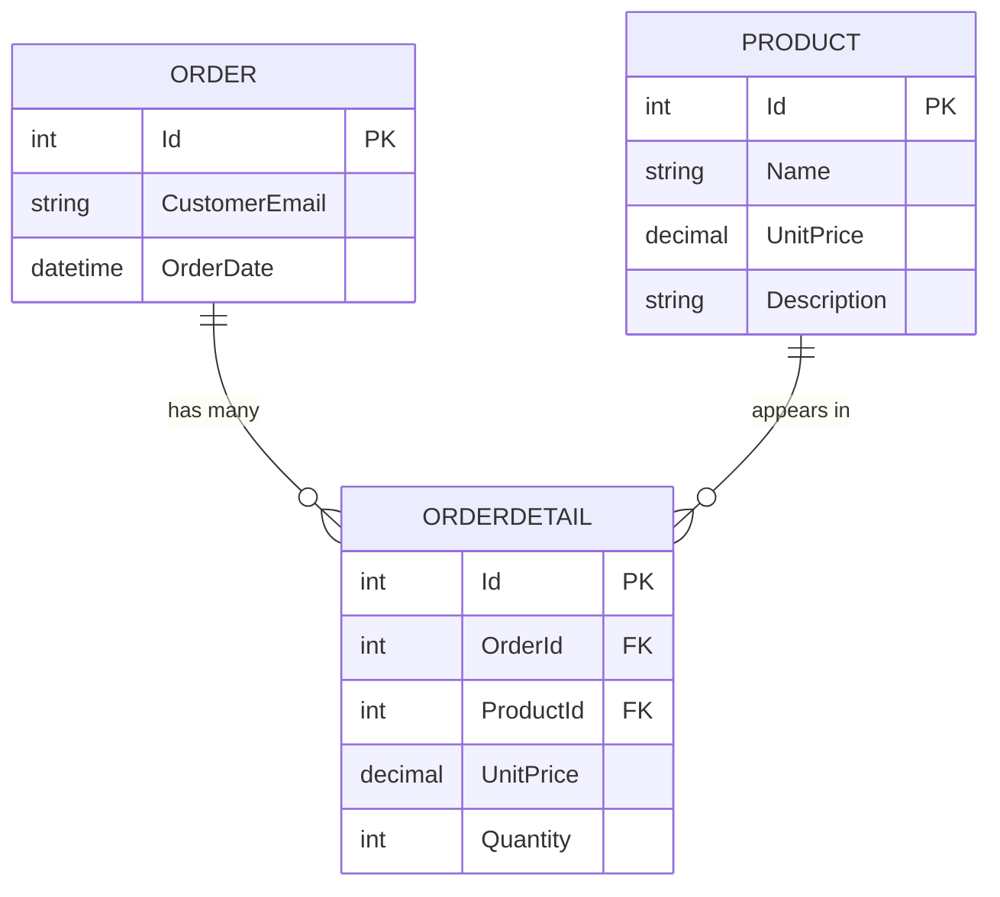

# EF Core: Setting Up the Model, Schemas, Excluding/Including Entities, Views and Table-Valued Functions

This README explains **six small projects** from the EF Core course in simple language:

| # | Project | Main idea |
|---|---|---|
| A | `EF005.SetupEFCoreModel` | What a `DbContext` and a `DbSet` are, and how to connect to the database |
| B1 | `EF009.BasicSetup` | Map entities to tables in **different schemas** (`Inventory.Products`, `Sales.Orders`) |
| B2 | `EF009.ExcludeEntities` | **Exclude** a class from the model: `Ignore<T>()` |
| B3 | `EF009.IncludeEntities` | **Include** entities without a `DbSet`, load related data with `Include`, use `Set<T>()` |
| B4 | `EF009.MappingView` | Map a class to a **database view** (`ToView`, `HasNoKey`) |
| B5 | `EF009.TableValuedFunction` | Map to a **table-valued function** and call it with `FromSqlInterpolated` |

```
Table of contents
1. Key words you need first
2. Part A: Setting up the model (EF005)
3. The shared model of EF009 (Product, Order, OrderDetail)
4. B1: BasicSetup (schemas)
5. B2: ExcludeEntities (Ignore)
6. B3: IncludeEntities (Include, Set<T>, how entities enter the model)
7. B4: MappingView (views and keyless entities)
8. B5: TableValuedFunction (ToFunction and FromSqlInterpolated)
9. Table vs View vs Function vs Raw SQL
10. A practice database script
11. Things to notice in the lesson code
12. Common errors
13. Cheat sheet
14. Exercises
```

> **Honest note:** several files were not in the code you pasted (`Wallet`, `Snapshot`, `AuditEntry`, `OrderWithDetailsView`, `OrderBill`, the `Product` of the Exclude project, the SQL objects). I wrote those parts from what the code obviously needs and marked them **(inferred)**. I could not run EF Core here, so the SQL shown is what EF Core normally generates.

---

# 1. Key words you need first

| Word | Simple meaning |
|---|---|
| **Entity** | A C# class that represents a row of a table (`Product`, `Order`) |
| **Model** | EF Core's **internal picture** of your entities, tables, columns and relationships. It is built the first time you use the context. |
| **`DbContext`** | Your **session** with the database. Everything goes through it. |
| **`DbSet<T>`** | "The table of `T`". `context.Products` = the Products table. |
| **Schema** | A **folder (namespace) inside the database** that groups tables: `Inventory.Products`, `Sales.Orders`. The default schema is `dbo`. |
| **Navigation property** | A property that points to a related entity (`OrderDetail.Order`, `Order.OrderDetails`) |
| **View** | A **saved SELECT** query that behaves like a read-only table |
| **Table-valued function (TVF)** | A database **function with parameters that returns a table** |
| **Keyless entity** | An entity with **no primary key** (used for views, functions and reports). Read-only. |

---

# 2. Part A: Setting up the model (`EF005.SetupEFCoreModel`)

```csharp
internal class AppDbContext : DbContext
{
    // Represent the collection of all entities
    public DbSet<Wallet> Wallets { get; set; } = null!;

    protected override void OnConfiguring(DbContextOptionsBuilder optionsBuilder)
    {
        base.OnConfiguring(optionsBuilder);

        var configuration = new ConfigurationBuilder()
          .AddJsonFile("appsettings.json")
          .Build();

        var constr = configuration.GetSection("constr").Value;

        optionsBuilder.UseSqlServer(constr);
    }
}
```

(The file was pasted twice, it is the same class.)

## 2.1 What the comment in the code says

> *"A DbContext instance represents a session with the database and can be used to query and save instances of your entities. DbContext is a combination of the Unit Of Work and Repository patterns."*

In easy words:

| Pattern | What it means here |
|---|---|
| **Repository** | `context.Wallets` is like a **collection of wallets**. You read, add and remove items from it, and you do not write SQL. |
| **Unit of Work** | The context **remembers every change** you make, then `SaveChanges()` sends **all of them together** as one transaction. |

```
       your code                        DbContext                       database
  ┌───────────────────┐          ┌─────────────────────┐          ┌────────────┐
  │ wallets.Add(...)  │ ───────► │ remembers the       │          │            │
  │ wallet.Balance += │ ───────► │ changes             │          │            │
  │ SaveChanges()     │ ───────► │ (Unit of Work)      │ ──SQL──► │  Wallets   │
  └───────────────────┘          └─────────────────────┘          └────────────┘
```

## 2.2 The pieces

| Piece | Meaning |
|---|---|
| `DbContext` | The base class that gives you everything |
| `DbSet<Wallet> Wallets` | The table of wallets. Each `DbSet` is a table you can query. |
| `= null!` | "EF Core will fill this in. Compiler, do not warn me about null." |
| `OnConfiguring` | EF Core calls it to find out **which database** to use |
| `ConfigurationBuilder().AddJsonFile("appsettings.json")` | Read the settings file |
| `GetSection("constr").Value` | Read the connection string (the key is named `constr`) |
| `UseSqlServer(constr)` | Use SQL Server with that connection string |
| `base.OnConfiguring(optionsBuilder)` | Run EF Core's own setup first (a good habit) |

## 2.3 The entity `Wallet` (inferred)

```csharp
public class Wallet
{
    public int Id { get; set; }          // primary key (by convention)
    public string Holder { get; set; }
    public decimal Balance { get; set; }
}
```

`appsettings.json`:

```json
{
  "constr": "Server=.;Database=WalletDb;Trusted_Connection=True;TrustServerCertificate=True;"
}
```

> Set the file to **Copy to Output Directory** or the program cannot find it. The packages needed: `Microsoft.EntityFrameworkCore.SqlServer` and `Microsoft.Extensions.Configuration.Json`.

---

# 3. The shared model of EF009

Most EF009 projects use the same three entities:

```csharp
[Table("Orders", Schema = "Sales")]
public class Order
{
    [Key]
    public int Id { get; set; }
    public string CustomerEmail { get; set; }
    public DateTime OrderDate { get; set; }
    public List<OrderDetail> OrderDetails { get; set; } = new List<OrderDetail>();
}

public class OrderDetail
{
    public int Id { get; set; }
    public int OrderId { get; set; }          // foreign key to Order
    public int ProductId { get; set; }        // foreign key to Product
    public decimal UnitPrice { get; set; }
    public int Quantity { get; set; }
    public Order Order { get; set; }          // navigation
    public Product Product { get; set; }     // navigation
}

public class Product
{
    public int Id { get; set; }
    public string Name { get; set; }
    public decimal UnitPrice { get; set; }
    public string Description { get; set; }
}
```



In words: an **Order** has many **OrderDetails** (the lines of the order). Each line points to one **Product**.

### Relationships by convention (nothing to configure)

EF Core builds the relationships **by itself** because of the names:

| It sees | It understands |
|---|---|
| `OrderDetail.OrderId` + `OrderDetail.Order` | A foreign key to `Order` |
| `OrderDetail.ProductId` + `OrderDetail.Product` | A foreign key to `Product` |
| `Order.OrderDetails` (a list) | The "many" side: one order has many details |

---

# 4. B1: BasicSetup (schemas)

## 4.1 What is a schema?

A schema groups tables inside a database. It helps to keep a big database tidy:

```
Database
├── Inventory            ← schema
│     └── Products       ← table
└── Sales                ← schema
      ├── Orders
      └── OrderDetails
```

Full names: `Inventory.Products`, `Sales.Orders`, `Sales.OrderDetails`. If you do not say anything, tables go into the default schema **`dbo`**.

## 4.2 The code

```csharp
public class AppDbContext : DbContext
{
    public DbSet<Product> Products { get; set; }
    public DbSet<Order> Orders { get; set; }
    public DbSet<OrderDetail> OrderDetails { get; set; }

    protected override void OnModelCreating(ModelBuilder modelBuilder)
    {
        modelBuilder.Entity<Product>()
            .ToTable("Products", schema: "Inventory")
            .HasKey(x => x.Id);

        modelBuilder.Entity<Order>()
            .ToTable("Orders", schema: "Sales")
            .HasKey(x => x.Id);

        modelBuilder.Entity<OrderDetail>()
            .ToTable("OrderDetails", schema: "Sales")
            .HasKey(x => x.Id);

        // modelBuilder.HasDefaultSchema("Sales");

        base.OnModelCreating(modelBuilder);
    }
    ...
}
```

| Code | Meaning |
|---|---|
| `modelBuilder.Entity<Product>()` | "I am configuring `Product`" |
| `.ToTable("Products", schema: "Inventory")` | The table is `Inventory.Products` |
| `.HasKey(x => x.Id)` | `Id` is the primary key |
| `// modelBuilder.HasDefaultSchema("Sales")` | (commented) One line to put **all** tables in the `Sales` schema unless a table says otherwise |

The program only reads the products:

```csharp
var context = new AppDbContext();
foreach (var product in context.Products)
    Console.WriteLine(product.Name);
```

```sql
SELECT [p].[Id], [p].[Description], [p].[Name], [p].[UnitPrice]
FROM [Inventory].[Products] AS [p]
```

Without `schema: "Inventory"` EF Core would query `[dbo].[Products]` and fail with `Invalid object name 'Products'`.

## 4.3 Two ways, and what to notice

`Order` is configured **twice** with the same value:

```csharp
[Table("Orders", Schema = "Sales")]          // Data Annotation on the class
public class Order { [Key] public int Id { get; set; } ... }

modelBuilder.Entity<Order>().ToTable("Orders", schema: "Sales").HasKey(x => x.Id);   // Fluent API
```

If they disagree, the **Fluent API wins** (Fluent > Data Annotations > Conventions). Here they agree, so one of them is enough. Also `[Key]` and `HasKey` are not even needed: a property named `Id` is a key by convention.

`HasDefaultSchema("Sales")` is useful when most tables live in one schema:

```csharp
modelBuilder.HasDefaultSchema("Sales");                                   // everything in Sales...
modelBuilder.Entity<Product>().ToTable("Products", schema: "Inventory");  // ...except Products
```

---

# 5. B2: ExcludeEntities (`Ignore`)

## 5.1 The problem

EF Core is **eager to include** types. If an entity has a property whose type is a class, EF Core thinks "this must be another entity" and tries to map it to a table (and complains that it needs a key).

In this lesson `Product` has a `Snapshot` property (inferred):

```csharp
// NOT stored in the database. It only records when/how the object was loaded in memory.
public class Snapshot
{
    public DateTime LoadedAt { get; set; } = DateTime.Now;
    public int Version { get; set; } = 1;
}

public class Product
{
    public int Id { get; set; }
    public string Name { get; set; }
    public decimal UnitPrice { get; set; }
    public string Description { get; set; }
    public Snapshot Snapshot { get; set; } = new Snapshot();
}
```

`Snapshot` has no table in the database. We must tell EF Core **to leave it alone**.

## 5.2 The solution

```csharp
modelBuilder.Ignore<Snapshot>();
```

`Ignore<Snapshot>()` means: "`Snapshot` is **not an entity**. No table, no columns, no relationship."

The program uses it like a normal property:

```csharp
foreach (var product in context.Products)
{
    Console.WriteLine($"{product.Name} \t\n...... loaded at " +
        $"{product.Snapshot.LoadedAt.ToString("yyyy-MM-dd hh:mm")}" +
        $"\nVersion: {product.Snapshot.Version}");
}
```

Possible output (the time is the moment the program ran):

```
Laptop
...... loaded at 2026-11-05 10:30
Version: 1
```

`LoadedAt` comes from C#, **not** from the database. EF Core never reads or writes `Snapshot`, and the `Product` constructor/initializer creates it.

## 5.3 Other ways to exclude

| Way | Where | Excludes |
|---|---|---|
| `modelBuilder.Ignore<Snapshot>()` | Fluent API | The whole **type** (everywhere) |
| `modelBuilder.Entity<Product>().Ignore(p => p.Snapshot)` | Fluent API | **One property** of one entity |
| `[NotMapped]` on the **class** `Snapshot` | Data Annotation | The whole type |
| `[NotMapped]` on the **property** `Product.Snapshot` | Data Annotation | One property |

Use it for helper objects, calculated values, and data that only exists in memory.

---

# 6. B3: IncludeEntities (how entities enter the model)

There are **three ways** an entity ends up in the model:

| # | Way | In this project |
|---|---|---|
| 1 | A **`DbSet<T>`** property on the context | `Products`, `Orders` |
| 2 | It is **reachable by a navigation property** from an entity already in the model | `OrderDetail` (through `Order.OrderDetails`) |
| 3 | You **mention it** in `modelBuilder.Entity<T>()` | `OrderDetail`, `AuditEntry` |

```
DbSet<Order> ──► Order ──(OrderDetails)──► OrderDetail ──(Product)──► Product
   (way 1)                  (way 2)                           (way 1, also has a DbSet)

modelBuilder.Entity<AuditEntry>()  ──►  AuditEntry   (way 3: no DbSet, no navigation)
```

## 6.1 The code

```csharp
public class AppDbContext : DbContext
{
    public DbSet<Product> Products { get; set; }
    public DbSet<Order> Orders { get; set; }       // <- no DbSet for OrderDetail!

    protected override void OnModelCreating(ModelBuilder modelBuilder)
    {
        modelBuilder.Entity<Product>().ToTable("Products", schema: "Inventory").HasKey(x => x.Id);
        modelBuilder.Entity<OrderDetail>().ToTable("OrderDetails", schema: "Sales").HasKey(x => x.Id);
        modelBuilder.Entity<AuditEntry>().HasKey(x => x.Id);     // included explicitly
        base.OnModelCreating(modelBuilder);
    }
}
```

`AuditEntry` (inferred):

```csharp
public class AuditEntry
{
    public int Id { get; set; }
    public string UserName { get; set; }
    public string Action { get; set; }
}
```

## 6.2 There is no `context.OrderDetails`

```csharp
//var ItemsInOrder1 = context
//    .OrderDetails
//    .Where(x => x.OrderId == 1); // compile time error
```

This does not compile because the context has **no `OrderDetails` property**. `OrderDetail` is in the **model** (EF Core knows it), but there is no **shortcut property** for it.

## 6.3 Two ways to reach it

### (a) Through the parent with `Include`

```csharp
var order1Details = context
     .Orders
     .Include(x => x.OrderDetails)
     .FirstOrDefault(x => x.Id == 1)
     .OrderDetails;

Console.WriteLine($"Items Count In Order 1 = {order1Details.Count()}");
```

`Include(x => x.OrderDetails)` means **"also load the order details of the order"**. This is called **eager loading**. The SQL is a join, roughly:

```sql
SELECT ... FROM [Sales].[Orders] AS [o]
LEFT JOIN [Sales].[OrderDetails] AS [o0] ON [o].[Id] = [o0].[OrderId]
WHERE [o].[Id] = 1
```

> **Very important:** EF Core does **not** load related data automatically. Without `Include`, `order.OrderDetails` is just the **empty list** created by `= new List<OrderDetail>()`, so `Count()` would print **0**, which looks like a valid answer but is wrong.

### (b) Directly with `Set<T>()`

```csharp
var details = context.Set<OrderDetail>().Where(x => x.OrderId == 1).ToList();
```

`context.Set<T>()` gives you the table of **any entity in the model**, even without a `DbSet` property. Use it when you want the details directly.

## 6.4 Adding an entity that has no `DbSet`

```csharp
var auditEntry = new AuditEntry { UserName = "issam", Action = "Read order count" };

context.Set<AuditEntry>().Add(auditEntry);

// context.SaveChanges(); // Error Invalid object
```

`Add` works because `AuditEntry` is in the model. But `SaveChanges()` is commented out because it fails with **`Invalid object name 'AuditEntry'`**.

Why? Being in the **model** does not create a **table**. The code only told EF Core about the class. The table must exist in the database (create it by hand, or use **migrations**). Without a `DbSet`, the default table name is the class name: `AuditEntry` in the `dbo` schema.

## 6.5 Null trap in the lesson code

```csharp
.FirstOrDefault(x => x.Id == 1).OrderDetails;
```

If there is no order with `Id` 1, `FirstOrDefault` returns `null` and `.OrderDetails` throws `NullReferenceException`. Safer:

```csharp
var order = context.Orders.Include(x => x.OrderDetails).FirstOrDefault(x => x.Id == 1);
if (order == null) { Console.WriteLine("Order not found"); return; }
Console.WriteLine($"Items Count In Order 1 = {order.OrderDetails.Count}");
```

---

# 7. B4: MappingView (views and keyless entities)

## 7.1 What is a view?

A **view** is a **saved SELECT query** stored in the database. You use it like a table, but it is **read-only** and usually joins several tables.

Example (inferred): a view that shows each order line with the product name:

```sql
CREATE VIEW dbo.OrderWithDetailsView AS
SELECT  o.Id            AS OrderId,
        o.CustomerEmail,
        o.OrderDate,
        p.Name          AS ProductName,
        od.UnitPrice,
        od.Quantity,
        od.UnitPrice * od.Quantity AS LineTotal
FROM Sales.Orders o
JOIN Sales.OrderDetails od ON od.OrderId = o.Id
JOIN Inventory.Products p  ON p.Id = od.ProductId;
```

Think of it as a "ready-made report".

## 7.2 The entity that matches the view (inferred)

```csharp
public class OrderWithDetailsView
{
    public int OrderId { get; set; }
    public string CustomerEmail { get; set; }
    public DateTime OrderDate { get; set; }
    public string ProductName { get; set; }
    public decimal UnitPrice { get; set; }
    public int Quantity { get; set; }
    public decimal LineTotal { get; set; }

    public override string ToString() =>
        $"Order {OrderId} | {CustomerEmail} | {ProductName} x{Quantity} @ {UnitPrice:N2} = {LineTotal:N2}";
}
```

The **property names must match the view's column names** (or you map them with `HasColumnName`).

## 7.3 The code

```csharp
public DbSet<OrderWithDetailsView> OrderWithDetails { get; set; }

modelBuilder.Entity<OrderWithDetailsView>()
    .ToView("OrderWithDetailsView")
    .HasNoKey();
```

| Code | Meaning |
|---|---|
| `DbSet<OrderWithDetailsView> OrderWithDetails` | The property you query (any name you like) |
| `.ToView("OrderWithDetailsView")` | "This entity comes from a **view**, not a table." EF Core will not try to create a table for it. |
| `.HasNoKey()` | A view has no primary key, so this is a **keyless entity** |

Program:

```csharp
foreach (var item in context.OrderWithDetails)
    Console.WriteLine(item);          // uses ToString()
```

SQL:

```sql
SELECT [o].[OrderId], [o].[CustomerEmail], [o].[OrderDate], [o].[ProductName],
       [o].[UnitPrice], [o].[Quantity], [o].[LineTotal]
FROM [OrderWithDetailsView] AS [o]
```

## 7.4 Keyless entities: the rules

| Allowed | Not allowed |
|---|---|
| Querying: `Where`, `OrderBy`, `ToList()`... | `Add`, `Update`, `Remove`, `SaveChanges` for them (a view is read-only here) |
| Use in reports, dashboards, summaries | They are **not tracked**, so EF Core does not remember changes |

Why use a view instead of a LINQ query with `Join`? The join is written **once, in the database**; it can be reused by other programs, optimized by DBAs, and the C# code stays simple.

---

# 8. B5: TableValuedFunction

## 8.1 What is a table-valued function?

A **table-valued function (TVF)** is like a **view with parameters**. You give it a value (for example an order id) and it returns a **table**.

Example (inferred):

```sql
CREATE FUNCTION dbo.GetOrderBill (@OrderId INT)
RETURNS TABLE
AS
RETURN
(
    SELECT  p.Name AS ProductName,
            od.UnitPrice,
            od.Quantity,
            od.UnitPrice * od.Quantity AS LineTotal
    FROM Sales.OrderDetails od
    JOIN Inventory.Products p ON p.Id = od.ProductId
    WHERE od.OrderId = @OrderId
);
```

Usage in SQL: `SELECT * FROM dbo.GetOrderBill(1)` gives the bill of order 1.

## 8.2 The entity (inferred)

```csharp
public class OrderBill
{
    public string ProductName { get; set; }
    public decimal UnitPrice { get; set; }
    public int Quantity { get; set; }
    public decimal LineTotal { get; set; }

    public override string ToString() => $"{ProductName} x{Quantity} @ {UnitPrice:N2} = {LineTotal:N2}";
}
```

## 8.3 The code

```csharp
// public DbSet<OrderBill> OrderBills { get; set; }      // commented out: no DbSet needed

modelBuilder.Entity<OrderBill>()
    .HasNoKey()
    .ToFunction("GetOrderBill");
```

| Code | Meaning |
|---|---|
| `HasNoKey()` | The result rows have no primary key |
| `.ToFunction("GetOrderBill")` | The entity's shape comes from the **function** `GetOrderBill` (so EF Core does not look for a table named `OrderBill`) |

### Calling the function with a parameter

```csharp
var order1BillDetails = new AppDbContext().Set<OrderBill>()
    .FromSqlInterpolated($"SELECT * FROM GetOrderBill({1})")
    .ToList();

foreach (var item in order1BillDetails)
    Console.WriteLine(item);
```

| Piece | Meaning |
|---|---|
| `Set<OrderBill>()` | The "table" of `OrderBill` (works without a `DbSet` property) |
| `FromSqlInterpolated($"...")` | Run **your own SQL** and map the rows to `OrderBill` |
| `{1}` | A C# value inside the interpolated string |
| `.ToList()` | Run the query now |

## 8.4 `FromSqlInterpolated` is safe (SQL injection)

It looks like string interpolation, but EF Core does **not** paste the value into the text. It turns each `{...}` into a **SQL parameter**:

```sql
-- what is really sent
SELECT * FROM GetOrderBill(@p0)        -- @p0 = 1
```

So a user cannot inject SQL through the value.

```csharp
int orderId = 1;

// SAFE: interpolated string passed directly to FromSqlInterpolated
.FromSqlInterpolated($"SELECT * FROM dbo.GetOrderBill({orderId})")

// UNSAFE: you build the string yourself, EF Core cannot see the value
var sql = $"SELECT * FROM dbo.GetOrderBill({orderId})";
.FromSqlRaw(sql)          // never do this with user input
```

## 8.5 Rules and tips for raw SQL

| Rule | Why |
|---|---|
| The query must return **all the columns** of the entity | EF Core maps columns to properties by name |
| Column names must match property names | Or map them with `HasColumnName` |
| Use `dbo.GetOrderBill(...)` with the **schema name** | Clear, and required for some function types |
| After `FromSql...` you can keep writing LINQ (`Where`, `OrderBy`) | EF Core wraps your SQL in a sub-query. Works only when the SQL is composable (a plain `SELECT`, not a stored procedure that does several things). |
| `Include` after `FromSql` works only for entities with keys | Keyless entities have no relationships |

> **Going further:** `ToFunction` does not know how to pass parameters. The lesson uses `FromSqlInterpolated` for that. Newer EF Core versions also let you map a C# method to the function with `HasDbFunction`, so you can write `context.GetOrderBill(1)` in LINQ without raw SQL.

---

# 9. Table vs View vs Function vs Raw SQL

| | **Table** | **View** | **Table-valued function** | **Raw SQL** (`FromSql`) |
|---|---|---|---|---|
| What it is | Stores data | A saved SELECT | A SELECT with parameters | Any SQL you write in C# |
| Has a key? | Yes | No (`HasNoKey`) | No (`HasNoKey`) | Depends on the entity |
| Read-only? | No | **Yes** | **Yes** | Yes (for keyless) |
| EF mapping | `ToTable` | `ToView` | `ToFunction` | `FromSqlInterpolated` |
| Parameters? | n/a | No | **Yes** | Yes (interpolated values) |
| Typical use | Normal CRUD | Reports, joins used in many places | Parameterized reports (for example "the bill of order X") | Special queries EF Core cannot express |
| Property in the context | `DbSet<T>` | `DbSet<T>` or `Set<T>()` | `Set<T>()` | `Set<T>()` / any entity |

The mapping methods you met in this lesson:

| Method | Meaning |
|---|---|
| `ToTable("Name", schema: "S")` | Map to a table in a schema |
| `HasKey(x => x.Id)` | Primary key |
| `HasDefaultSchema("S")` | Default schema for all tables |
| `Ignore<T>()` | Exclude a type from the model |
| `Entity<T>()` | Include/configure an entity (even without a `DbSet`) |
| `ToView("Name")` | Map to a view |
| `HasNoKey()` | Keyless entity (read-only) |
| `ToFunction("Name")` | Map to a table-valued function |

---

# 10. A practice database script

Use this to try every project (SQL Server). It is an **example** that matches the entities above.

```sql
CREATE DATABASE ShopDb;
GO
USE ShopDb;
GO
CREATE SCHEMA Inventory;
GO
CREATE SCHEMA Sales;
GO

CREATE TABLE Inventory.Products (
    Id INT IDENTITY(1,1) PRIMARY KEY,
    Name NVARCHAR(100) NOT NULL,
    UnitPrice DECIMAL(18,2) NOT NULL,
    Description NVARCHAR(500) NULL
);

CREATE TABLE Sales.Orders (
    Id INT IDENTITY(1,1) PRIMARY KEY,
    CustomerEmail NVARCHAR(200) NOT NULL,
    OrderDate DATETIME2 NOT NULL
);

CREATE TABLE Sales.OrderDetails (
    Id INT IDENTITY(1,1) PRIMARY KEY,
    OrderId INT NOT NULL REFERENCES Sales.Orders(Id),
    ProductId INT NOT NULL REFERENCES Inventory.Products(Id),
    UnitPrice DECIMAL(18,2) NOT NULL,
    Quantity INT NOT NULL
);
GO

INSERT INTO Inventory.Products (Name, UnitPrice, Description) VALUES
 ('Laptop', 25000, 'Work laptop'), ('Mouse', 300, 'Wireless mouse'), ('Keyboard', 800, 'Mechanical keyboard');

INSERT INTO Sales.Orders (CustomerEmail, OrderDate) VALUES ('mona@example.com', SYSDATETIME());

INSERT INTO Sales.OrderDetails (OrderId, ProductId, UnitPrice, Quantity) VALUES
 (1, 1, 25000, 1), (1, 2, 300, 2);
GO

-- the view of section 7
CREATE VIEW dbo.OrderWithDetailsView AS
SELECT o.Id AS OrderId, o.CustomerEmail, o.OrderDate, p.Name AS ProductName,
       od.UnitPrice, od.Quantity, od.UnitPrice * od.Quantity AS LineTotal
FROM Sales.Orders o
JOIN Sales.OrderDetails od ON od.OrderId = o.Id
JOIN Inventory.Products p  ON p.Id = od.ProductId;
GO

-- the function of section 8
CREATE FUNCTION dbo.GetOrderBill (@OrderId INT)
RETURNS TABLE
AS
RETURN
(
    SELECT p.Name AS ProductName, od.UnitPrice, od.Quantity, od.UnitPrice * od.Quantity AS LineTotal
    FROM Sales.OrderDetails od
    JOIN Inventory.Products p ON p.Id = od.ProductId
    WHERE od.OrderId = @OrderId
);
GO
```

What each project should print with this data:

| Project | Expected output |
|---|---|
| BasicSetup | `Laptop`, `Mouse`, `Keyboard` |
| ExcludeEntities | Each product name with the load time and `Version: 1` |
| IncludeEntities | `Items Count In Order 1 = 2` |
| MappingView | `Order 1 \| mona@example.com \| Laptop x1 @ 25,000.00 = 25,000.00` and `... Mouse x2 @ 300.00 = 600.00` |
| TableValuedFunction | `Laptop x1 @ 25,000.00 = 25,000.00` and `Mouse x2 @ 300.00 = 600.00` |

---

# 11. Things to notice in the lesson code

| What you see | Why it matters |
|---|---|
| `var context = new AppDbContext();` without `using` | A shortcut for the lesson. In real code use `using (var context = ...)` so the connection is closed (see the previous README). |
| `Order` is configured by an attribute **and** by Fluent API; `[Key]` and `HasKey` repeat the convention | Harmless duplicates. Fluent API wins if they ever disagree. |
| The Exclude project has no `ToTable` for `Order` | `Order` is mapped by its `[Table("Orders", Schema = "Sales")]` attribute. |
| `IncludeEntities` has no `DbSet<OrderDetail>` | `OrderDetail` is reached by `Include` or `Set<OrderDetail>()`. |
| `.FirstOrDefault(x => x.Id == 1).OrderDetails` | `NullReferenceException` if order 1 does not exist. |
| `SaveChanges()` for `AuditEntry` is commented out | The table does not exist: being in the model does not create it. |
| `OrderBill` has its `DbSet` commented out | Not needed: `Set<OrderBill>()` works. |
| `FromSqlInterpolated($"SELECT * FROM GetOrderBill({1})")` | Prefer `dbo.GetOrderBill(...)`, and list the columns instead of `*` in real code. |
| `new AppDbContext().Set<OrderBill>()` | A new context is created and never disposed. Fine for a demo. |
| `Console.WriteLine(item)` for views/functions | Prints the class name unless the entity overrides `ToString()`. |
| `OnConfiguring` repeats the same code in every project | Real apps register the context once (`AddDbContext`) and read the connection string from configuration. |
| The projects do not use migrations | EF Core maps to a database that already exists. |

---

# 12. Common errors

| Error (short) | Meaning | Fix |
|---|---|---|
| `Invalid object name 'Products'` | Wrong schema or table name | `ToTable("Products", schema: "Inventory")` |
| `Invalid object name 'AuditEntry'` | The class is in the model, the table is not in the database | Create the table (or use migrations) |
| `The entity type 'Snapshot' requires a primary key` | EF Core tried to treat a helper class as an entity | `modelBuilder.Ignore<Snapshot>()` or `[NotMapped]` |
| `OrderDetails` count is `0` although rows exist | Related data not loaded | Add `.Include(x => x.OrderDetails)` |
| `NullReferenceException` after `FirstOrDefault` | No row found | Check for `null` first |
| `'AppDbContext' does not contain a definition for 'OrderDetails'` | No `DbSet` property | Use `Set<OrderDetail>()` or `Include` |
| `The entity type 'X' requires a primary key to be defined. If you intended to use a keyless entity type, call 'HasNoKey'` | A view/function entity is missing `HasNoKey()` | `.ToView("...").HasNoKey()` |
| `Unable to track an instance of type 'X' because it does not have a primary key` | You tried to `Add/Update/Remove` a keyless entity. They are read-only. | Only query keyless entities |
| `Invalid column name 'X'` (raw SQL) | The SQL does not return a column the entity expects (or the name differs) | Return all columns with matching names |
| `FileNotFoundException: appsettings.json` | Settings file not copied to the output folder | Set **Copy to Output Directory** |

---

# 13. Cheat sheet

| I want to... | Code |
|---|---|
| Put a table in a schema | `.ToTable("Products", schema: "Inventory")` |
| Put all tables in a schema | `modelBuilder.HasDefaultSchema("Sales")` |
| Exclude a class | `modelBuilder.Ignore<Snapshot>()` or `[NotMapped]` |
| Include a class without a `DbSet` | `modelBuilder.Entity<AuditEntry>()` |
| Query an entity without a `DbSet` property | `context.Set<AuditEntry>()` |
| Load related data | `.Include(x => x.OrderDetails)` |
| Map to a view | `.ToView("MyView").HasNoKey()` |
| Map to a function | `.HasNoKey().ToFunction("MyFunction")` |
| Call a function with parameters | `Set<T>().FromSqlInterpolated($"SELECT * FROM dbo.MyFunction({id})")` |

---

# 14. Exercises

1. **Schemas.** Uncomment `HasDefaultSchema("Sales")` in BasicSetup and remove the `schema:` argument from `Orders` and `OrderDetails`. Does it still work? Which table needs its own schema?
2. **Ignore.** Remove `modelBuilder.Ignore<Snapshot>()` and run the program. Read the error. Then fix it with `[NotMapped]` instead.
3. **Include.** Print the **product name** of every detail of order 1 (hint: `.Include(x => x.OrderDetails).ThenInclude(d => d.Product)`).
4. **Prove the trap.** Run the IncludeEntities query **without** `Include` and compare the count with the real number of rows.
5. **Set<T>.** Write the order-1 details query with `context.Set<OrderDetail>()` instead of `Include`.
6. **Audit.** Create the `AuditEntry` table, uncomment `SaveChanges()`, and check that the row is saved. What is the exact SQL error before you create the table?
7. **View.** Add a `Where(x => x.LineTotal > 500)` to the view query and look at the SQL (`ToQueryString()`).
8. **Function.** Make the order id come from `Console.ReadLine()` and pass it through `FromSqlInterpolated`. Why is this safe from SQL injection?
9. **Compose.** Add `.OrderByDescending(x => x.LineTotal)` after `FromSqlInterpolated`. What does the SQL look like?
10. **Decide.** For each case choose table, view, function or raw SQL: (a) save a new order, (b) a dashboard that joins 4 tables, (c) the bill of a given order, (d) a one-time complicated report.

---

# Summary

| Idea | One line |
|---|---|
| `DbContext` | A session: Repository (collections) + Unit of Work (`SaveChanges`) |
| `DbSet<T>` | The table of `T` |
| Schema | A folder for tables: `ToTable("Products", schema: "Inventory")` |
| Model | EF Core's picture of your entities; built from `DbSet`s, navigation properties and `Entity<T>()` |
| `Ignore<T>()` / `[NotMapped]` | Keep a class **out** of the model |
| `Entity<T>()` / `Set<T>()` | Put a class **in** the model without a `DbSet`, and query it |
| `Include` | Load related data (EF Core never loads it by itself) |
| View | `ToView` + `HasNoKey`: read-only report entity |
| Table-valued function | `ToFunction` + `HasNoKey`, called with `FromSqlInterpolated` (safe parameters) |
